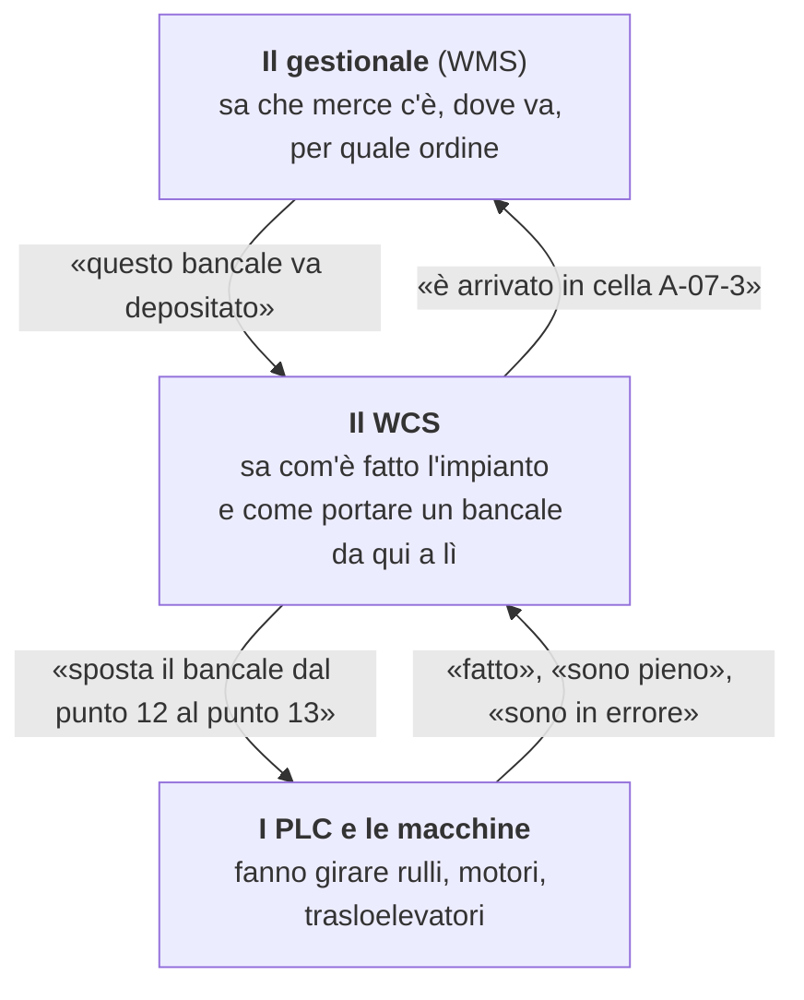
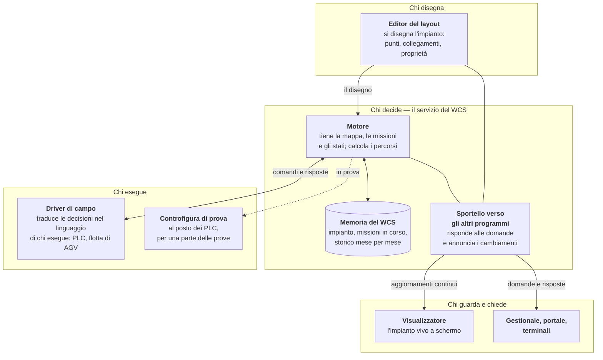

> **Historical — not current.** Internal design notes of Sun Tech, written in Italian on 2026-09-08. They describe the system as it was then and are kept for reference only; the current documentation is in [docs/](../../README.md).

# Come funziona il WCS

> **Nota per il repository pubblico.** Questo documento e' stato scritto per il repository interno. Non sono pubblicati: l'Editor WinForms (`Wcs.Editor`), `Wcs.Viewer.Test`, il driver PLC di Sun Tech con il suo protocollo e il suo simulatore (proprietari) e i documenti che lo descrivono (fra questi la mappa dell'area `WCS/doc/README.md` e il registro del debito tecnico), l'importatore che migra gli impianti dal database del gestionale di Sun Tech, gli script della demo, le specifiche, i piani, la coda dei lavori e i rapporti delle revisioni, e il monorepo del gestionale (i riferimenti `Kazam:`). I collegamenti a quelle parti sono resi come testo e segnati «(non pubblicato)». `Common` qui e' una cartella normale, non un submodule.

Questo documento spiega che cosa fa il WCS di Kazam, come è fatto e che cosa lo distingue da come
questi sistemi si costruiscono di solito. È scritto per chi deve valutare l'impianto senza essere
un programmatore: non contiene codice, e i nomi tecnici compaiono una volta sola, fra parentesi,
per chi poi ne parlerà con i tecnici.

Gli altri documenti di questa cartella sono di natura diversa:
[per-cominciare.md](per-cominciare.md) è la guida per chi arriva sul progetto e deve modificarlo,
README.md (non pubblicato) la mappa per chi sviluppa, [valutazione.md](valutazione.md) il giudizio
tecnico su che cosa vale e che cosa va rifatto, debito-tecnico.md (non pubblicato) il registro
dei difetti noti.

## Il posto del WCS

In un magazzino automatico ci sono tre livelli, e fanno tre mestieri diversi.

Il gestionale ragiona di **merce**: codici, lotti, ordini, giacenze. I PLC ragionano di
**movimento**: accendere un motore per tre secondi, leggere una fotocellula. Fra i due manca
qualcuno che ragioni di **percorso**: sapere che per andare dalla baia di carico alla cella
richiesta si passa per quella rulliera, poi per quel trasloelevatore, e che se quel
trasloelevatore è fermo esiste un'altra strada. Quel qualcuno è il WCS.

È il livello che di solito costa di più, perché in genere si scrive su misura per ogni impianto.
È esattamente il punto in cui questo sistema fa una scelta diversa.

## L'idea: l'impianto è un disegno, non un programma

Il modo consueto di costruire questo livello è descrivere i percorsi uno per uno: dalla stazione 3
alla cella 12 si passa di qui, dalla stazione 4 alla cella 12 si passa di là. Sono regole scritte
nel software o in tabelle di ricette. Funzionano finché l'impianto resta identico: aggiungere una
rulliera, invertire un senso di marcia o mettere in servizio un secondo trasloelevatore significa
riaprire il software.

Qui l'impianto è **una mappa disegnata**, e il calcolo delle strade è compito della macchina.

Si apre un editor grafico (l'*Editor*), si trascinano i pezzi dell'impianto e si tirano le frecce
che li collegano. Due sole cose contano:

- **i punti**: ogni pezzo dell'impianto che può tenere un bancale o farlo passare — una rulliera,
  un trasloelevatore, una cella di stoccaggio, un polmone, un distributore rotante, oppure un
  gruppo che raccoglie più pezzi che lavorano insieme;
- **i collegamenti**: una freccia orientata da un punto a un altro, con una priorità. La freccia
  dice «da qui si può andare là»; la priorità dice quale strada preferire quando ce n'è più d'una.

Da quel disegno il motore costruisce la mappa che userà per decidere. Nell'impianto su cui il
sistema è collaudato oggi la mappa ha 51 punti e 59 collegamenti, più la corrispondenza fra le
porte dell'automazione e le 2.729 celle del magazzino.

Quell'impianto però è il banco di prova, non la misura di quello che il sistema regge. **Il motore
che fa questi conti è lo stesso che ha governato 50 impianti**, e ha gestito fino a 386 macchine
in contemporanea. Sono 50 disegni diversi serviti dallo stesso programma: è la prova pratica che
l'idea funziona, ed è più convincente di qualunque argomento.

**Aggiungere un pezzo all'impianto è disegnarlo.** Non c'è codice da scrivere per insegnare al
sistema che esiste una nuova strada: c'è una freccia da tirare. È la prima delle due idee su cui
poggia tutto il resto.

### Chi porta il bancale non cambia il disegno

La mappa non è fatta di nastri: è fatta di **punti** e di **trasferimenti fra punti**. Che il
trasferimento lo esegua una rulliera, un trasloelevatore o **un veicolo a guida automatica** è una
questione di chi porta, non di come si chiede.

Il modo di chiedere infatti è sempre lo stesso, ed è deliberatamente povero: «sposta questa unità
di carico da questo punto a quel punto, entro questo tempo», e in risposta «fatto», oppure «non
fatto, per questo motivo». Fra il motore e le macchine c'è **un'interfaccia dichiarata**, un
elenco fisso di richieste e di risposte in cui non compaiono né indirizzi di memoria né telegrammi:
compaiono punti, unità di carico ed esiti.

Da questo discende il modo di mettere in campo una macchina nuova. **Il driver di una macchina si
scrive rispettando quell'interfaccia**: parla il linguaggio del costruttore da un lato e
l'interfaccia del WCS dall'altro. Il motore non sa e non deve sapere chi ci sia dall'altra parte,
quindi non cambia; non cambia nemmeno il disegno dell'impianto. Una flotta di veicoli a guida
automatica, per il WCS, è un esecutore come un altro: gli si chiede di spostare, e risponde quando
ha finito.

## Come si muove un bancale

La seconda idea è che il sistema non esegue un piano deciso all'inizio, ma **riconsidera la
situazione a ogni passo**.

Quando il gestionale chiede di muovere un bancale, il WCS apre una **missione**: «questa unità di
carico deve arrivare là». La missione non contiene la strada. La strada nasce un pezzo alla volta.

Il giro C→D→E→F si ripete per ogni salto. Ogni volta il motore riguarda com'è l'impianto *in
quell'istante*: quali punti sono liberi, quali occupati da altri bancali, quali fuori servizio,
quali movimenti sono già stati promessi ad altre missioni. Poi decide il salto successivo.

Le conseguenze pratiche sono tre.

- **Gli imprevisti non fermano il sistema.** Se durante il viaggio un trasloelevatore va in
  errore, il bancale non resta con un piano ormai sbagliato in mano: al salto successivo il
  motore trova un'altra strada, se esiste, e la prende.
- **Non esiste una tabella dei percorsi da mantenere.** Le strade sono un risultato del disegno,
  non un elenco scritto a mano che qualcuno deve ricordarsi di aggiornare.
- **Il sistema sa dire di no in modo utile.** Se una strada non c'è — perché il pezzo è fuori
  servizio, o perché il disegno non la prevede — la missione resta in attesa e il fatto è
  registrato, invece di produrre un movimento sbagliato.

## Come sceglie la strada

Il motore cerca sulla mappa tutte le strade che portano dalla posizione attuale alla destinazione,
e ne sceglie una. Il criterio è dichiarato e ha due gradini:

1. **vince la strada con meno passaggi**;
2. fra le più corte, **vince la meno affollata**: quella che attraversa i dispositivi con meno
   movimenti già in attesa. Fra due strade lunghe uguali, il bancale prende quella dove troverà
   meno coda.

La priorità che si assegna alle frecce nel disegno decide in quale ordine il motore prova le
strade, e quindi quale sceglie quando anche l'attesa è pari: è il modo con cui chi conosce
l'impianto indica la via preferita.

Non si usano tempi stimati. È una scelta deliberata: il WCS ragiona su ciò che conosce con
certezza — quanti pezzi si attraversano, quali sono liberi, quanti movimenti sono già in attesa su
ciascuno — e non su durate che dipendono da carichi, velocità e usura, e che sarebbero
supposizioni. Un percorso più corto e prevedibile vale più di un percorso teoricamente più veloce
ma calcolato su numeri inventati.

La ricerca sa anche tenere conto di vincoli che l'impianto reale impone:

- **passaggi obbligati**: a una missione si può imporre di transitare per un punto preciso del
  percorso, e allora le strade che non ci passano vengono scartate; non è la norma, è uno strumento
  per i casi in cui il passaggio va forzato;
- **gruppi**: più pezzi che lavorano come un blocco unico — per esempio le posizioni in profondità
  di una stessa corsia — sono attraversati una volta sola, senza girare dentro il gruppo;
- **pezzi fuori linea**: normalmente si evitano; se non esiste nessuna strada senza di loro, il
  motore riprova considerandoli, così un impianto in condizioni degradate continua a lavorare
  invece di bloccarsi del tutto.

## Lo schema logico: i componenti

Il sistema è fatto di pezzi con un compito solo ciascuno. Chi valuta l'impianto trova utile sapere
che cosa si installa e che cosa fa.

- **L'editor del layout.** Il programma con cui si disegna l'impianto e si configurano le
  proprietà di ogni pezzo. Serve al momento della messa in servizio e a ogni modifica
  dell'impianto. Non è collegato alle macchine: parla solo con il servizio del WCS.
- **Il motore.** Il cuore: tiene in memoria la mappa, le missioni aperte, lo stato di ogni pezzo
  dell'impianto, e prende le decisioni. È la parte che sa *come* si muove un bancale.
- **La memoria del WCS.** Il WCS conserva i propri dati per conto proprio: il disegno
  dell'impianto, le missioni in corso, le code, e uno storico diviso per mese di tutto quello che è
  successo. Sono file suoi, che vivono accanto al servizio: per conservare quello che sa non usa il
  database del gestionale. Al gestionale continua a chiedere quello che il gestionale sa, a
  cominciare da quale cella usare.
- **Lo sportello verso gli altri programmi.** Il modo in cui gestionale, portale, terminali e
  visualizzatore parlano con il WCS: chiedono («che cosa sta facendo il bancale 4711?», «quali
  celle sono servite dall'automazione?»), comandano («ferma il motore», «scarica questo bancale»)
  e ricevono gli aggiornamenti nel momento in cui accadono, senza doverli andare a cercare.
- **Il driver di campo.** Traduce «sposta dal 12 al 13» nel linguaggio di chi esegue davvero il
  movimento — i PLC di una linea di trasporto, la flotta di veicoli a guida automatica — e riporta
  al motore quello che succede: bancale arrivato, dispositivo occupato, errore. È un componente
  sostituibile: il motore conosce il contratto, non chi c'è dall'altra parte.
- **La controfigura di prova.** Prende il posto del driver di campo e permette di far girare il
  sistema senza PLC. Oggi è deliberatamente minima: risponde ai comandi ma non riproduce tutti i
  segnali che l'impianto vero manda, quindi serve per le prove di configurazione, non come banco di
  collaudo completo.
- **Il visualizzatore.** La vista dell'impianto in tempo reale: i bancali sui dispositivi, gli
  stati a colori, la freccia del prossimo movimento. È la finestra che l'operatore guarda.

Il servizio del WCS è un solo programma che si installa e si avvia come servizio di Windows.
Editor, visualizzatore, gestionale e terminali sono suoi clienti: nessuno di loro tocca i dati del
WCS direttamente.

## La divisione dei ruoli con il gestionale

Il WCS non sostituisce il gestionale e non ne duplica il lavoro. La linea è netta, ed è la parte
che più spesso viene fatta male negli impianti che abbiamo visto.

| Domanda | Chi risponde |
|---|---|
| Che merce è, di chi è, per quale ordine esce | **il gestionale** |
| In quale cella conviene metterla, secondo le regole del magazzino | **il gestionale** |
| Come ci si arriva, per quali passaggi, in che ordine | **il WCS** |
| Dov'è adesso quel bancale, che cosa sta facendo | **il WCS** |
| Che cosa è successo nell'impianto in agosto | **il WCS** |
| Quanti pezzi di quel codice ho a magazzino | **il gestionale** |

Ognuno dei due possiede i propri dati e li espone all'altro con domande e risposte, non lasciando
che l'altro gli legga le tabelle sotto. È la scelta che rende i due sistemi indipendenti nella
manutenzione: un cambiamento nello schema dell'uno non può rompere l'altro, perché l'altro quello
schema non lo conosce.

## Che cosa si vede mentre l'impianto lavora

- **La pianta viva**: ogni dispositivo con il suo stato, i bancali dove si trovano, e al
  passaggio del mouse la strada che il bancale sta per fare.
- **Le missioni**: quali sono aperte, da dove a dove, a che punto sono.
- **I comandi**: quelli eseguiti, quelli in attesa, quelli finiti in errore, con chi li ha chiesti.
- **Lo storico**: che cosa si è mosso, quando, per quale lavorazione. È diviso per mese, si tiene
  per il periodo che si decide, e alimenta gli indicatori di produzione.

## Che cosa rende diversa questa soluzione

Riassunto per chi valuta, in quattro punti.

1. **L'impianto si disegna, non si programma.** La topologia è un dato, non codice: modifiche e
   ampliamenti dell'impianto sono un lavoro di configurazione, non di sviluppo. È ciò che di solito
   costa di più e che qui costa meno. Non è una promessa: **lo stesso motore ha già servito 50
   impianti diversi**. E poiché la mappa è fatta di punti e trasferimenti, non di nastri, lo stesso
   disegno vale per un impianto servito da veicoli a guida automatica.
2. **I percorsi sono calcolati sulla situazione del momento**, non presi da una tabella scritta
   una volta per tutte. L'impianto reagisce agli imprevisti da solo, e non c'è un elenco di
   percorsi da tenere aggiornato a mano.
3. **Il criterio di scelta è dichiarato e verificabile**: meno passaggi, poi meno coda. Chi
   gestisce l'impianto può capire e prevedere perché il sistema ha scelto quella strada — cosa che
   con i criteri basati su tempi stimati non accade quasi mai.
4. **Il confine con il gestionale è un contratto, non un database condiviso.** Il WCS si installa,
   si aggiorna e si collauda per conto proprio, con la propria memoria; il gestionale gli parla
   chiedendo. Questo apre la porta a impianti con gestionali diversi e rende possibile provare il
   WCS senza toccare il sistema che manda avanti il magazzino.

A queste si aggiunge una scelta di metodo che si vede nei fatti: ogni componente ha la propria
documentazione verificata contro il codice da uno strumento automatico, e i difetti noti stanno in
un registro pubblico con una stima del costo. Chi adotta il sistema sa che cosa sta prendendo,
compreso quello che manca.

## Che cosa non c'è ancora

Onestà sui confini, perché servono anche a chi valuta.

- **Il driver della macchina non è compreso**: l'interfaccia verso le macchine è dichiarata e non
  è legata a una marca, ma il pezzo che la implementa per un impianto va scritto. Vale la pena
  dire con precisione che cosa i 50 impianti dimostrano e che cosa no: dimostrano che il disegno
  regge 50 topologie diverse, non che l'interfaccia sia già stata provata contro macchine di
  costruttori diversi. È lavoro circoscritto e non tocca il motore, ma è lavoro da fare, e il
  primo driver che si scriverà dirà anche se l'interfaccia ha davvero la forma giusta.
- L'editor del layout e il visualizzatore girano **su Windows**. Il servizio del WCS, la parte che
  deve restare accesa, non ha vincoli di piattaforma nella sua costruzione e si installa oggi come
  servizio di Windows; su altri sistemi operativi non è stato provato.
- Il gestionale resta **la parte competente su dove mettere la merce**: il WCS non sostituisce le
  regole di stoccaggio, ci si appoggia.

---

*Documento scritto il 2026-09-07. Per il dettaglio tecnico dei componenti si parte da
README.md (non pubblicato); per il giudizio su punti di forza e limiti,
[valutazione.md](valutazione.md).*
