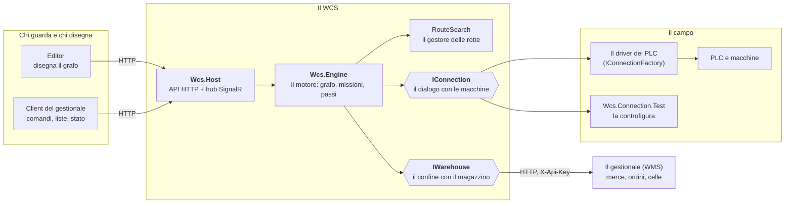
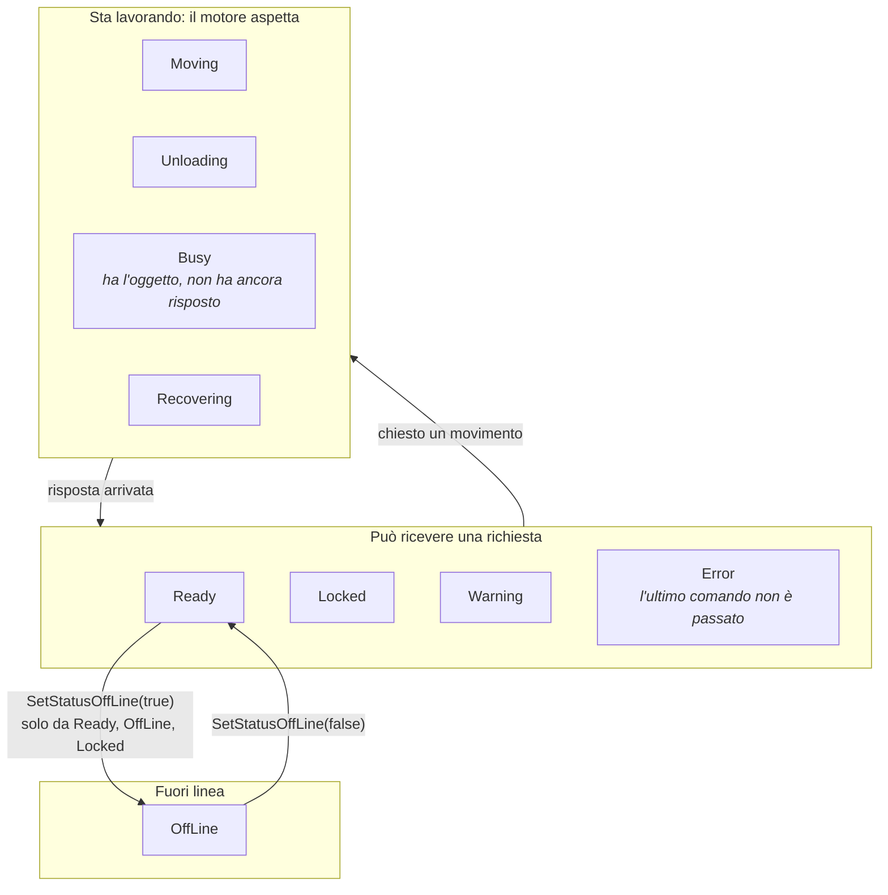
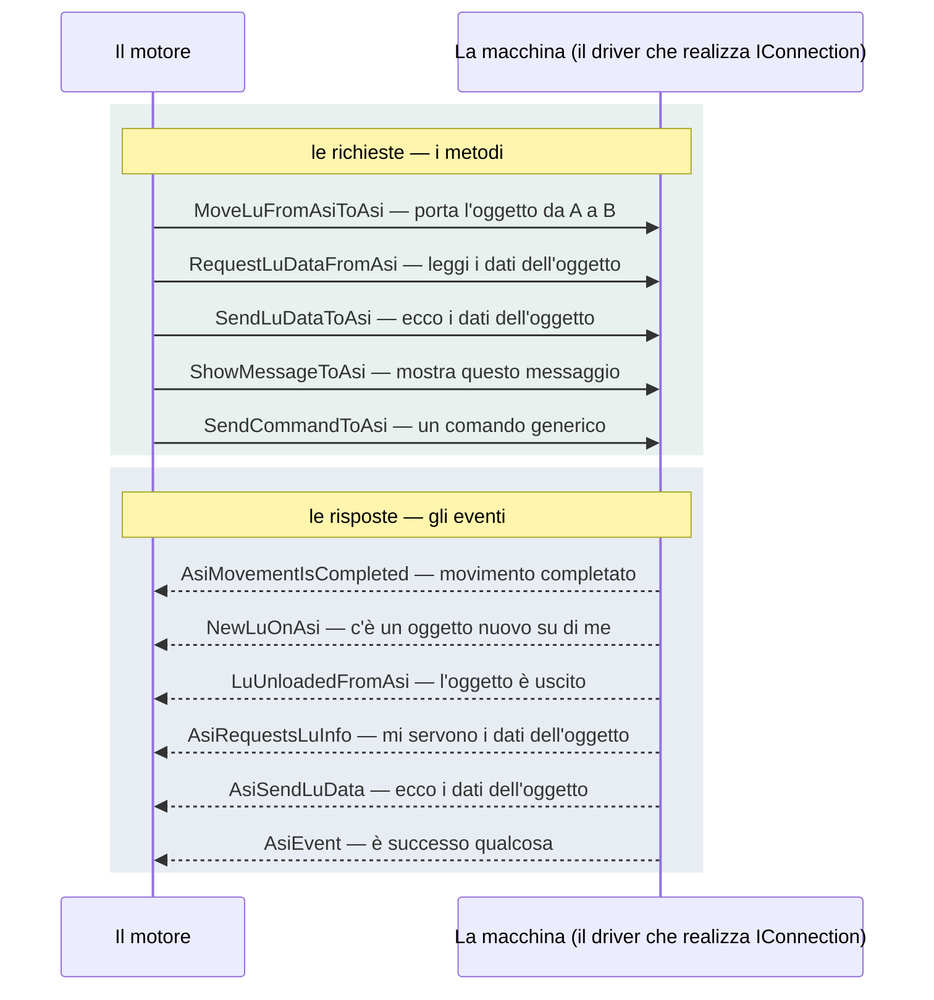
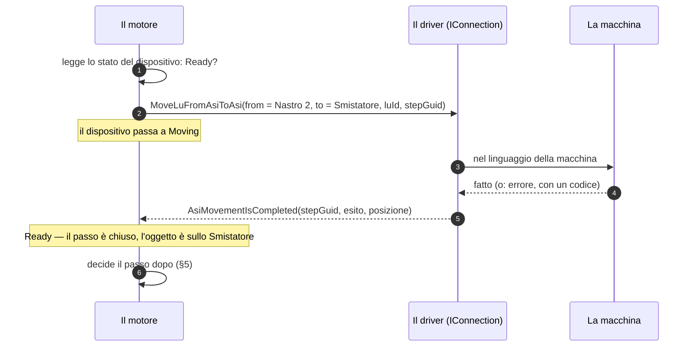
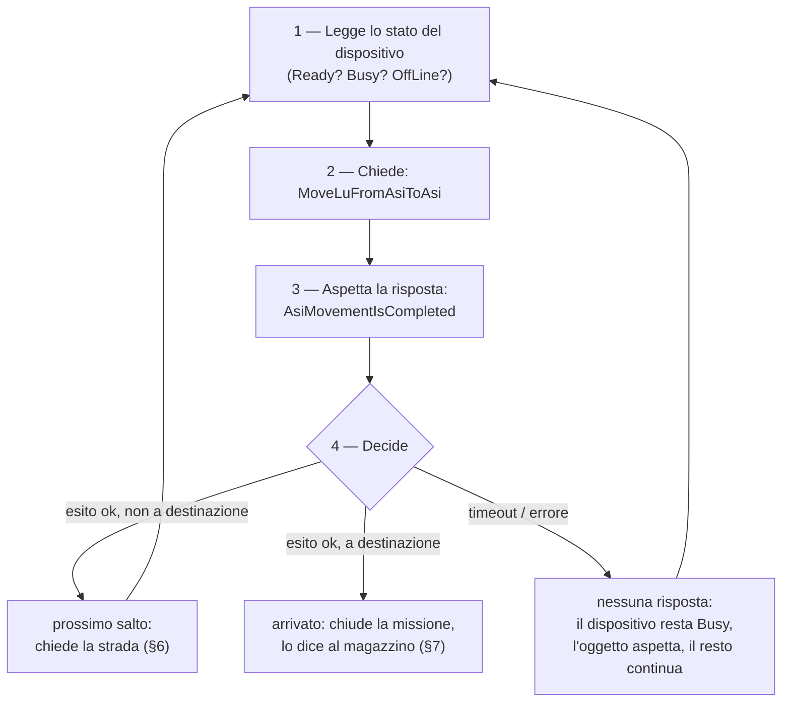
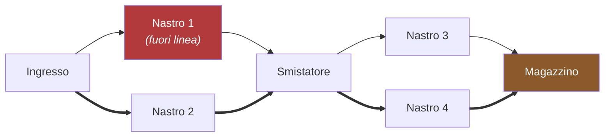
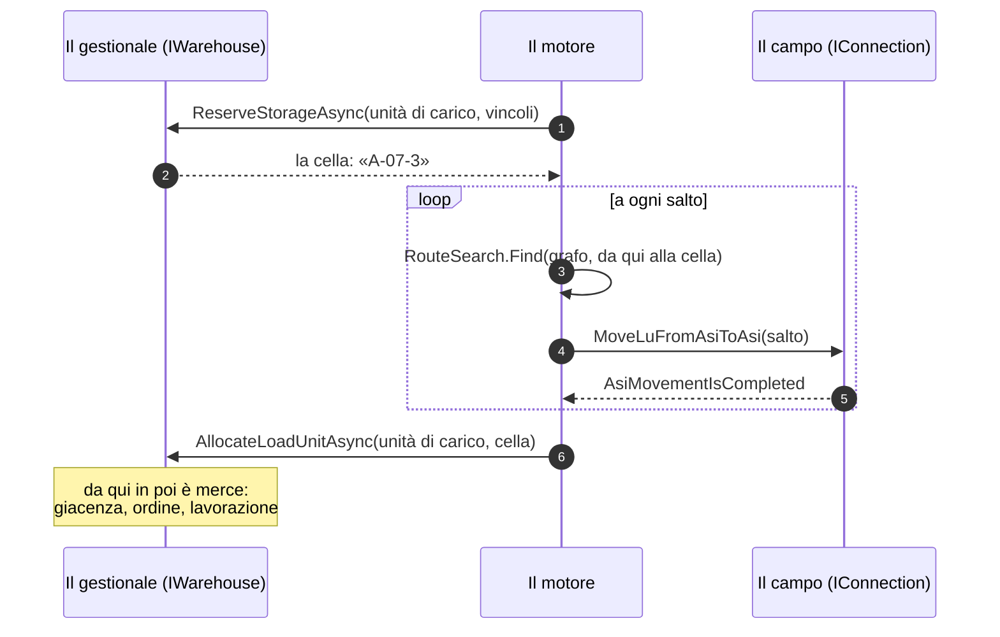
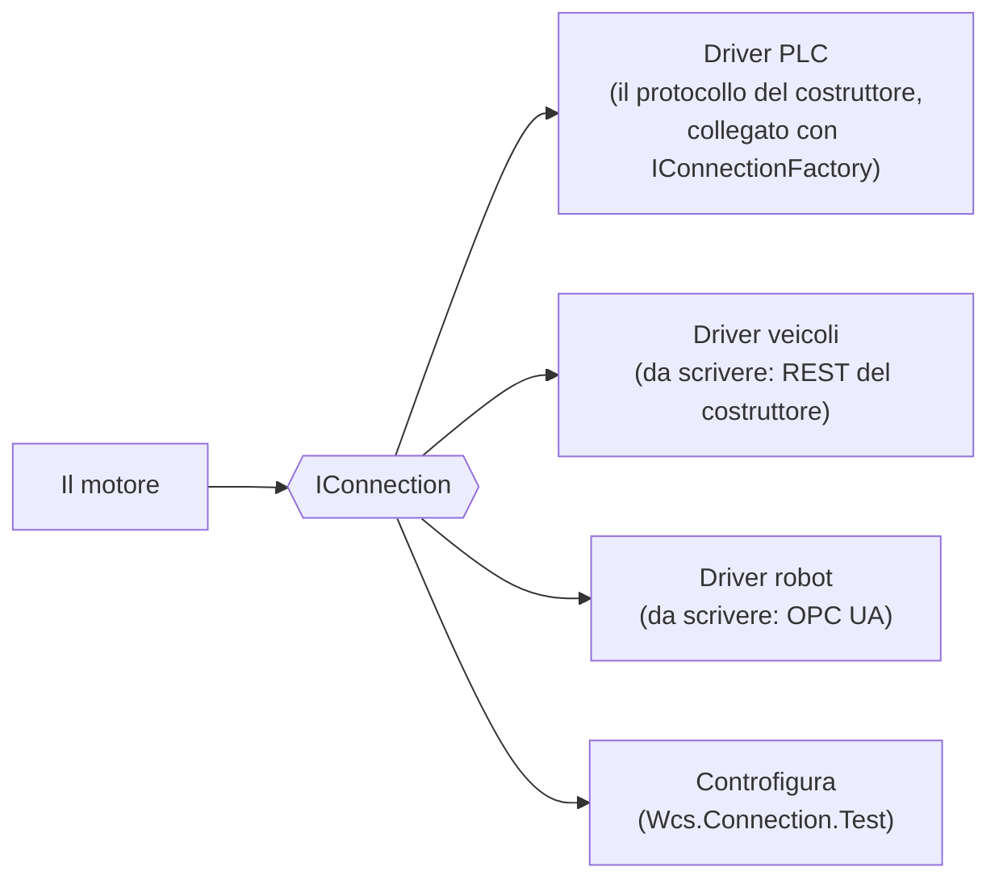
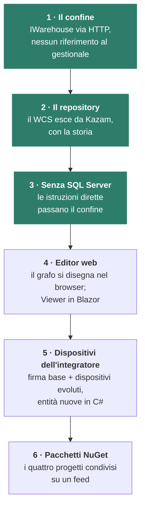
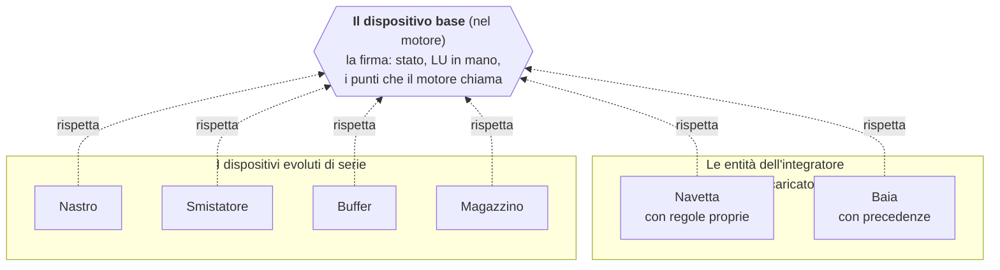

> **Historical — not current.** Internal design notes of Sun Tech, written in Italian on 2026-09-12. They describe the system as it was then and are kept for reference only; the current documentation is in [docs/](../../README.md).

# La logica di funzionamento del WCS — per chi programma

> **Nota per il repository pubblico.** Questo documento e' stato scritto per il repository interno. Non sono pubblicati: l'Editor WinForms (`Wcs.Editor`), `Wcs.Viewer.Test`, il driver PLC di Sun Tech con il suo protocollo e il suo simulatore (proprietari) e i documenti che lo descrivono (fra questi la mappa dell'area `WCS/doc/README.md` e il registro del debito tecnico), l'importatore che migra gli impianti dal database del gestionale di Sun Tech, gli script della demo, le specifiche, i piani, la coda dei lavori e i rapporti delle revisioni, e il monorepo del gestionale (i riferimenti `Kazam:`). I collegamenti a quelle parti sono resi come testo e segnati «(non pubblicato)». `Common` qui e' una cartella normale, non un submodule.

Questo documento spiega **come ragiona** il WCS, partendo dall'idea da cui nasce e arrivando ai
nomi del codice: le interfacce, gli enumeratori, le firme. È scritto per un programmatore che
deve capire il prodotto prima di toccarlo — o che deve **scrivere il driver di una macchina
nuova** e vuole sapere che cosa il WCS si aspetta da lui.

Non è la guida all'area (quella è [per-cominciare.md](per-cominciare.md), con l'avvio, le suite e
le sorprese) e non è la mappa dei progetti (README.md (non pubblicato)). È il documento del *perché*:
letto questo, il resto del codice ha un ordine. La versione per chi non programma è la
presentazione «Il WCS: come ragiona una fila di macchine» e, in prosa,
[come-funziona.md](come-funziona.md).

Gli esempi sono inventati: nomi come «Nastro 2» o «Smistatore» non corrispondono a nessun
impianto reale.

## 1. L'idea, e la sua traduzione nel codice

Immaginate una fila di persone che si passano oggetti. Ognuna riceve un oggetto da chi le sta
prima, fa la sua parte, e lo passa a chi le sta dopo. **Nessuna vede tutta la fila**: sa solo che
cosa ha in mano e a chi passarlo. Ognuna ha una logica sua — c'è chi sa solo passare avanti, chi
sceglie fra due uscite, chi mette via e va a riprendere — e quella logica non la decide il
coordinatore: la decidono la macchina e il software che la governa.

Il WCS è chi coordina la fila. Non muove i motori: **chiede** a ciascuno di fare una cosa che sa
fare («prendi», «scarica», «porta da A a B», «leggi i dati»), **aspetta** che quello risponda com'è
andata, e **decide** il passo successivo. E la strada non la inventa lui: l'oggetto, a ogni passo,
la chiede a chi conosce la mappa.

Ogni pezzo della metafora ha un nome nel codice.

| Nella fila | Nel WCS | Dove |
|---|---|---|
| Una persona della fila | un **dispositivo** (`AutomationDevice`), con un tipo e uno stato | `Wcs.Engine/src/Items/` |
| Quello che sa fare | il **tipo** del dispositivo: `DeviceTypes` | `Wcs.Common/src/Enums.cs:96` |
| Com'è messa adesso | lo **stato** del dispositivo: `DeviceStatusTypes` | `Wcs.Common/src/Enums.cs:73` |
| L'oggetto che passa di mano | l'**unità di carico** (LU, *load unit*: un bancale, una cassa) | `AutomationDevice.LoadedLu`, `luId` in `IConnection` |
| La fila, con le sue biforcazioni | il **grafo dell'impianto**: `RouteGraph` di `RouteNode` ed `RouteEdge` | `Wcs.Engine/src/Routing/RouteGraph.cs` |
| Il coordinatore | il **motore** (`Wcs.Engine`, il *Navigator*) | `Wcs.Engine/src/Navigator.cs` |
| Chi conosce la mappa | il **gestore delle rotte**: `RouteSearch.Find` | `Wcs.Engine/src/Routing/RouteSearch.cs:26` |
| Il dialogo con ogni persona | l'interfaccia **`IConnection`**: otto metodi, sei eventi | `Wcs.Connection.Interface/src/IConnection.cs` |
| La macchina e il suo software | il PLC e il **driver** che realizza `IConnection` | `Wcs.Connection.Test` (il driver di prova), o un driver proprio collegato con `IConnectionFactory` |
| Il viaggio di un oggetto | una **missione** (`PathMission`) fatta di **passi** (`MissionStep`) | `Wcs.Engine/src/Items/` |
| Il magazzino, che ragiona di merce | il gestionale dietro il contratto **`IWarehouse`** | `Wcs.Wms.Contracts/src/IWarehouse.cs` |

## 2. I componenti, e chi parla con chi



Tre cose da fissare subito.

1. **Il motore gira in un solo processo, l'host.** Editor e Client sono client puri: parlano con
   l'host via HTTP e ricevono gli stati dall'hub. Nessuno di loro carica il motore.
2. **Il motore non conosce nessuna macchina.** Conosce `IConnection`. Chi c'è dall'altra parte —
   un PLC, una flotta di veicoli, una controfigura di prova — lo decide il driver.
3. **Il motore non conosce il gestionale.** Conosce `IWarehouse`, dichiarato dal WCS stesso; la
   realizzazione HTTP (`HttpWarehouse`) è l'unico punto da cui parla col magazzino, e l'host la
   cabla all'avvio. Nessun progetto del WCS referenzia i progetti del gestionale: un test lo
   dimostra (`EngineDependenciesTest`).

## 3. Ogni persona ha la sua logica: tipi e stati

### 3.1 Il tipo dice che cosa sa fare

`DeviceTypes` (`Wcs.Common/src/Enums.cs:96`) è la capacità della macchina, quella che nel
disegno dell'impianto si assegna al nodo.

| Tipo | La persona della fila che… | Esempio inventato |
|---|---|---|
| `Automation` | passa avanti quello che riceve | un nastro, una rulliera |
| `Loading` | è il punto in cui gli oggetti entrano nella fila | l'ingresso da un'area manuale |
| `Buffer` | tiene un oggetto in attesa finché non c'è posto oltre | una baia di attesa |
| `LoadingAndBuffer` | fa entrambe le cose | una baia d'ingresso con attesa |
| `Storage` | mette via e va a riprendere | il magazzino automatico |
| `CircularDistributor` | sceglie fra più uscite girando | uno smistatore rotante |
| `GroupOfAutomationDevices` | un blocco di persone che lavora come una sola | una navetta con i suoi punti di scambio |

Il tipo non è una classe per macchina: è un enumeratore letto dal grafo. **Una macchina in più
è un nodo in più nel disegno**, non una riga di codice in più nel motore.

### 3.2 Lo stato dice com'è messa adesso

Il WCS **legge lo stato prima di chiedere**. `DeviceStatusTypes` (`Wcs.Common/src/Enums.cs:73`):



Valori: `Ready`, `Moving`, `Loading`, `Unloading`, `Busy`, `Recovering`, `OffLine`, `Locked`,
`Warning`, `Error`. La macchina a stati (`AutomationDeviceStateMachine`) **non ha una tabella di
transizioni**: ogni stato può seguire qualunque altro, con due sole guardie — si va fuori linea
solo da `Ready`, `OffLine` o `Locked`, e si torna in linea solo da `OffLine`
(`CanChangeToOfflineState`). Quello che il motore guarda davvero è la partizione qui sopra:
`Moving`, `Recovering`, `Unloading` e `Busy` sono gli stati in cui **si aspetta una risposta**
(`IsMovementOrBusyState`), e in quelli non si chiede. Due regole che sorprendono chi arriva:

- **`Error` è uno stato logico, non un allarme del campo.** Significa «l'ultimo comando non è
  passato», e se ne esce riprovando: da `Error` si va a `Moving` come da `Ready`. Non c'è un
  reset da fare.
- **Un `Storage` non cambia mai stato**: resta `Ready` per tutta la vita del processo. Il
  magazzino automatico è trattato a parte in tutto il motore (`OpenConnection` non gli assegna
  una connessione, `ExecuteSteps` lo esclude).

### 3.3 Il viaggio di un oggetto è una missione

Una missione (`PathMission`) è un'unità di carico più una destinazione, con un tipo
(`MissionTypes`, `Wcs.Common/src/Enums.cs:172`): `Storing` (deposito), `Extraction`
(prelievo), `ChangeStoreLocation`, `MovingToItem` (porta a quel punto), `StoringByPickUp`,
`Rejection` (rifiuto), `PickUpAndStoreAgain`, `DefragmentCell`. I passi (`MissionStep`) sono i singoli salti da
un dispositivo al successivo, e **non esistono tutti alla partenza**: vengono creati un salto
alla volta, come si vedrà al §5.

## 4. Il dialogo: `IConnection`

Il contratto verso il campo è deliberatamente povero. **Otto metodi** sono quello che il motore
chiede; **sei eventi** sono quello che la macchina racconta. Nell'interfaccia non compaiono
indirizzi di memoria né telegrammi: compaiono punti dell'impianto, unità di carico ed esiti.



### 4.1 Le richieste (i metodi)

| Metodo | Che cosa chiede |
|---|---|
| `MoveLuFromAsiToAsi(RunAsi sourceItem, DataAsi actionItemPerformer, DataAsi fromAsi, DataAsi toAsi, Guid stepGuid, decimal luId, int luHandlingMode = 0)` | **il comando fondamentale**: porta l'unità di carico `luId` da `fromAsi` a `toAsi`; `actionItemPerformer` è chi esegue fisicamente il movimento (può non essere né l'origine né la destinazione); `stepGuid` correla la risposta al passo |
| `MoveLuFromAsiToAsi(RunAsi sourceItem, DataAsi actionItemPerformer, Guid groupedMovementId, List<MovementLuDataCommand> loadUnitsToMove, int luHandlingMode = 0)` | la stessa cosa per più unità insieme (un movimento raggruppato) |
| `RequestLuDataFromAsi(RunAsi item)` | leggi e mandami i dati dell'oggetto che hai lì |
| `SendLuDataToAsi(RunAsi item, LuInfoDataCommand value)` | il verso opposto: il motore dice alla macchina i dati dell'oggetto |
| `ShowMessageToAsi(RunAsi destinationItem, string message)` | testo per l'operatore, sul posto |
| `SendCommandToAsi(RunAsi destinationItem, int commandCode, List<string?> parameters)` | via di servizio generica; oggi senza chiamanti nel motore, ma ogni driver la realizza (fa parte dell'interfaccia) |
| `OpenConnection()`, `CloseConnection()`, `Dispose()` | il ciclo di vita del collegamento |

Due tipi dato portano tutto il resto:

- **`DataAsi(string? asi, string? subitem, string? partition)`** è l'**indirizzo logico** di un
  punto: tre stringhe che il driver sa tradurre nel proprio mondo (per il PLC standard sono i
  campi di un telegramma; per un altro hardware saranno quello che serve a lui). Il motore non
  le interpreta.
- **`RunAsi`** è la carta d'identità del dispositivo che chiede: `ItemGuid` (il nodo del grafo),
  `TimeOutPeriod`, `DelayToStepDone`, `ErrorResultCode`, `ResultType`. Il driver la riceve e la
  restituisce negli eventi, così il motore sa chi sta parlando.

### 4.2 Le risposte (gli eventi)

| Evento | Che cosa racconta la macchina | Dati |
|---|---|---|
| `AsiMovementIsCompleted` | il movimento è finito, con l'esito e le posizioni finali | `AsiMovementIsCompletedEventArgs` |
| `NewLuOnAsi` | c'è un oggetto nuovo su di me — che il motore **non** aveva messo lì | `NewLuOnAsiEventArgs` |
| `LuUnloadedFromAsi` | l'oggetto è uscito da me (scaricato) | `LuUnloadedFromAsiEventArgs` |
| `AsiRequestsLuInfo` | mi servono i dati di questo oggetto | `AsiRequestsLuInfoEventArgs` |
| `AsiSendLuData` | ecco i dati dell'oggetto (risposta a `RequestLuDataFromAsi`) | `AsiSendLuDataEventArgs` |
| `AsiEvent` | è successo questo, con questi parametri (il canale generico) | `AsiEventEventArgs` |

I delegati stanno in `Wcs.Connection.Interface/src/Handlers.cs`; gli `EventArgs` in `Events/`, i
dati che trasportano in `ConnectionData/`. Il motore si iscrive a tutti e sei in un solo punto,
`DeviceConnections` (`Wcs.Engine/src/Collections/DeviceConnections.cs:377-382`).

### 4.3 Un salto, dall'inizio alla fine



Il `stepGuid` che il motore passa e ritrova nell'evento è **la correlazione**: senza, una
risposta non si sa a quale domanda appartenga. Un driver che la perde per strada rompe il
dialogo anche se il movimento fisico è andato bene.

## 5. Chiede, aspetta la risposta, poi decide

Il motore non ha un `Main`. Ha **tre cicli** che girano finché vive (il dettaglio in
[per-cominciare.md §5](per-cominciare.md#5-i-tre-cicli-che-tengono-vivo-il-motore)):

| Ciclo | Cadenza | Fa |
|---|---|---|
| il battito | ogni secondo, sempre | scrive i contatori di stato, allinea i timer dei dispositivi |
| la coda dei percorsi | ogni 10 ms, solo in `Run` | prende una missione senza strada e gliela costruisce |
| il processo principale | ogni secondo | esegue i comandi arrivati; poi, solo in `Run`, assegnazioni ed estrazioni |

Il ciclo di decisione per un singolo oggetto è questo, ripetuto **a ogni salto**:



Tre regole di casa, che sono anche il modo in cui si leggono i difetti.

- **Nessuna risposta non è un silenzio: è un fatto.** Il dispositivo resta `Busy` finché non
  parla, l'oggetto aspetta, il motore lo scrive nel proprio registro. Il resto della fila non
  si ferma: la coda dei percorsi lavora sulle altre missioni.
- **Il WCS segnala fatti, non trae conseguenze.** «L'oggetto è arrivato in cella» è un fatto che
  il WCS dice al magazzino; che cosa ne consegue per l'ordine, la giacenza, la lavorazione lo
  decide il gestionale (§7).
- **Non c'è un thread per dispositivo.** Il motore non è una schiera di worker che si contendono
  risorse: è una sequenza di decisioni su uno stato condiviso. I difetti di concorrenza, quando
  ci sono, stanno nell'ordine delle decisioni, non nei contenitori.

## 6. L'oggetto chiede la strada

L'impianto è **una mappa, non un programma**: i punti e i collegamenti sono dati disegnati
nell'Editor e salvati nel database del WCS, e a runtime diventano un `RouteGraph`:

```csharp
public sealed record RouteNode(/* id, tipo, stato, gruppo, … */);
public sealed record RouteEdge(Guid SourceId, Guid DestinationId, int Priority);
public sealed class RouteGraph
{
    public RouteGraph(IEnumerable<RouteNode> nodes, IEnumerable<RouteEdge> edges);
    public RouteNode? Node(Guid id);
    public bool Contains(Guid id);
    public IReadOnlyList<RouteEdge> OutgoingFrom(Guid id);
}
```

La domanda alla mappa è un `RouteRequest`, e la risposta una lista di salti:

```csharp
public sealed record RouteRequest(
    Guid SourceId,                       // da dove
    Guid DestinationId,                  // a dove
    Guid GatewayId,                      // un punto da cui la rotta DEVE passare (Guid.Empty se nessuno)
    bool IgnoreItemStatus,               // ignora lo stato dei dispositivi (solo PickUpAndStoreAgain)
    bool ConsiderOffLineAvailable,       // seconda passata: accetta anche i fuori linea
    IReadOnlySet<Guid> ItemsToDiscard);  // dispositivi da scartare

public readonly record struct RouteHop(Guid FromId, Guid ToId, int FromGroupRoutePath);

public static IReadOnlyList<RouteHop> Find(RouteGraph graph, RouteRequest request);
```

`RouteSearch.Find` è **puro**: riceve il grafo e la domanda, restituisce i salti, non tocca
nulla. Si prova senza motore, senza database, senza macchine.



Il criterio ha due gradini, ed è dichiarato:

1. **vince la strada con meno passaggi**;
2. fra le più corte, **vince la meno affollata**: quella che attraversa i punti con meno
   movimenti già in attesa.

La `Priority` delle frecce decide l'**ordine di esplorazione**, quindi la scelta a parità anche
di affollamento: è il modo con cui chi conosce l'impianto indica la via preferita. **Non si usano
tempi stimati**, per scelta: il motore ragiona su ciò che conosce con certezza — quanti punti,
quali liberi, quanti movimenti in coda — non su durate che dipendono da carico e usura.

Tre vincoli in più: il **gateway** (una missione può essere obbligata a passare per un punto, e
le strade che non ci passano non valgono); i **gruppi** (`GroupOfAutomationDevices`) si
attraversano una volta sola; i **fuori linea** si evitano, ma se non esiste nessuna strada senza
di loro il chiamante riprova con `ConsiderOffLineAvailable = true`, così un impianto degradato
continua a lavorare invece di fermarsi.

E il punto che cambia tutto: **la strada si chiede a ogni salto**, non alla partenza. Se il Nastro
1 va fuori linea mentre l'oggetto è ancora sull'Ingresso, il salto successivo lo evita; non
esiste da nessuna parte un elenco delle tappe deciso all'inizio.

## 7. Due mestieri: il magazzino ragiona di merce, il WCS di percorso

`IWarehouse` (`Wcs.Wms.Contracts/src/IWarehouse.cs`) è il confine col gestionale, dichiarato
dal WCS. Le sue operazioni si leggono in quattro famiglie:

| Famiglia | Esempi | Il verso |
|---|---|---|
| **domande** sul magazzino | `DescribeCellAsync`, `LocateLoadUnitAsync`, `GetCellBusyStateAsync`, `GetAreaTopologyAsync` | il WCS chiede |
| **prenotazioni** | `ReserveStorageAsync`, `GetStorageReservationAsync`, `ReleaseStorageReservationAsync` | il WCS chiede una cella, il magazzino la sceglie |
| **lavoro pronto** | `GetPendingNoteWorkAsync`, `GetPendingExtractionWorkAsync` | il WCS chiede che cosa c'è da fare |
| **fatti** | `AllocateLoadUnitAsync`, `ReleaseLoadUnitAsync`, `ReportExtractionOutcomesAsync`, `ReportMissionServedAssignmentAsync` | il WCS racconta com'è andata |



La regola di fallimento è una sola: se il gestionale non risponde, `HttpWarehouse` solleva
`WarehouseUnavailableException` e il motore tratta la cosa come **un fatto** — la missione
aspetta, l'host resta vivo, si riprova. Un 404 è una risposta dove il contratto lo dichiara
(per esempio `LocateLoadUnitAsync` che restituisce `null`), non un errore.

Il verso opposto — il gestionale che dice al WCS «deposita questo», «preleva quello», «fermati»
— passa dall'**API dell'host** (`POST /api/v1/commands`, con un `commandType`), non da
`IWarehouse`. Le due direzioni hanno due contratti.

## 8. Qualunque macchina, purché parli il dialogo

Questa è la conseguenza pratica di tutto il documento. **Il driver di una macchina nuova si
scrive contro `IConnection`**, non derivandolo dal driver esistente: parla il linguaggio del
costruttore da un lato e il dialogo del WCS dall'altro. Il motore non sa e non deve sapere chi
c'è dall'altra parte, quindi non cambia; non cambia nemmeno il disegno dell'impianto.



### 8.1 Che cosa deve fare un driver

1. **Realizzare `IConnection`**: gli otto metodi e i sei eventi, più `Id` e `Managed`.
2. **Tradurre `DataAsi`** nel proprio indirizzamento. Le tre stringhe (`Asi`, `Subitem`,
   `Partition`) sono quelle scritte nel disegno dell'impianto per quel nodo: il driver decide
   che cosa significano per lui.
3. **Rispondere sempre, e con la correlazione.** A ogni `MoveLuFromAsiToAsi` deve seguire un
   `AsiMovementIsCompleted` con lo stesso `stepGuid`, che il movimento sia riuscito o no.
   Un driver che non risponde lascia il dispositivo `Busy`: il motore lo tollera, ma la fila
   si accorcia.
4. **Raccontare quello che il motore non sa.** Se la macchina vede un oggetto che il motore non
   ha messo lì, `NewLuOnAsi`; se lo perde, `LuUnloadedFromAsi`. Sono gli eventi che tengono il
   modello del motore allineato al campo.
5. **Non decidere.** Il driver non sceglie strade, non conosce le missioni, non parla col
   magazzino. Se si ritrova a farlo, sta facendo il mestiere del motore.

### 8.2 Lo scheletro

```csharp
using Wcs.Connection.Interface;
using Wcs.Connection.Interface.CommandData;

public sealed class VehicleFleetConnection(decimal id, IVendorFleetApi fleet) : IConnection
{
    public decimal Id { get; } = id;
    public bool Managed { get; set; }

    public event Handlers.AsiEventEventHandler? AsiEvent;
    public event Handlers.AsiMovementIsCompletedEventHandler? AsiMovementIsCompleted;
    public event Handlers.AsiRequestsLuInfoEventHandler? AsiRequestsLuInfo;
    public event Handlers.AsiSendLuDataEventHandler? AsiSendLuData;
    public event Handlers.LuUnloadedFromAsiEventHandler? LuUnloadedFromAsi;
    public event Handlers.NewLuOnAsiEventHandler? NewLuOnAsi;

    public void OpenConnection() => fleet.Connect(onArrived: RaiseMovementCompleted);
    public void CloseConnection() => fleet.Disconnect();
    public void Dispose() => CloseConnection();

    public void MoveLuFromAsiToAsi(RunAsi sourceItem, DataAsi performer, DataAsi fromAsi, DataAsi toAsi,
        Guid stepGuid, decimal luId, int luHandlingMode = 0)
    {
        // DataAsi.Asi e' il nome della stazione per la flotta; Subitem e Partition qui non servono.
        fleet.Order(stepGuid, from: fromAsi.Asi, to: toAsi.Asi, payload: luId);
    }

    public void MoveLuFromAsiToAsi(RunAsi sourceItem, DataAsi performer, Guid groupedMovementId,
        List<MovementLuDataCommand> loadUnitsToMove, int luHandlingMode = 0)
        => throw new NotSupportedException("la flotta muove un'unità per volta");

    public void RequestLuDataFromAsi(RunAsi item) { /* la flotta non legge etichette: nessuna risposta possibile */ }
    public void SendLuDataToAsi(RunAsi item, LuInfoDataCommand value) { }
    public void ShowMessageToAsi(RunAsi destinationItem, string message) => fleet.Notify(message);
    public void SendCommandToAsi(RunAsi destinationItem, int commandCode, List<string?> parameters) { }

    private void RaiseMovementCompleted(Guid stepGuid, bool ok, string station)
        => AsiMovementIsCompleted?.Invoke(this, /* AsiMovementIsCompletedEventArgs con stepGuid, esito, posizione */ null!);
}
```

Lo scheletro è volutamente incompleto: gli `EventArgs` si costruiscono con i dati di
`ConnectionData/`, e il driver di prova (`Wcs.Connection.Test/src/Connection.cs`) mostra come se ne riempiono due. Quello che conta è la
forma: **nessuna logica di percorso, nessun accesso al magazzino, una risposta per ogni
domanda**.

### 8.3 Dove si aggancia

Oggi la scelta del driver è un `switch` su `ConnectionTypes` in
`DeviceConnections.OpenConnection` (`Wcs.Engine/src/Collections/DeviceConnections.cs:313-317`):
`Test` prende la controfigura, `Connected` prende la connessione che il driver installato ha costruito per il PLC del dispositivo. **Un terzo driver oggi richiede un `case` in più lì**: è l'unico punto del motore
che nomina un'implementazione, e trasformarlo in un registro di driver per tipo di connessione è
il lavoro da fare quando arriverà il primo hardware diverso. La roadmap ([roadmap.md](roadmap.md))
lo registra fra le cose che pesano.

### 8.4 Come si prova

Il modello è quello delle suite esistenti: il motore si esercita con un `IConnection` finto e un
`IWarehouse` finto (`FakeWarehouse` in `Wcs.Wms.Contracts/tests/`), senza database e senza
macchine. Per un driver nuovo la prova è speculare: si chiama `MoveLuFromAsiToAsi` e si
verifica che arrivi un `AsiMovementIsCompleted` con lo stesso `stepGuid`, che un oggetto visto
dal campo produca `NewLuOnAsi`, e che `CloseConnection` non lasci nulla aperto. La regola di
casa è **test rosso prima**: un test che nasce verde non prova niente.

## 9. Dove va il prodotto: la roadmap

Le tappe dichiarate dal proprietario del progetto, nell'ordine in cui si fanno (il dettaglio e lo
stato aggiornato in [roadmap.md](roadmap.md)).



Le tappe 1, 2 e 3 sono fatte — la 3 fra l'11 e il 12 settembre 2026, in sedici compiti: sotto
`WCS/Wcs.Engine/src` non c'è più un'istruzione T-SQL, e `Wms:ConnectionString`, `MsSqlHelper` e
`Navigator.Database` sono usciti dal WCS. Le altre sono dichiarate e da specificare; le decisioni
prese in corso d'opera nella tappa 3 stanno in [roadmap.md](roadmap.md).

### 9.1 La tappa 5: le entità logiche di movimentazione

L'ordine fra la 4 e la 5 è stato **invertito il 2026-09-12**: prima l'Editor web, poi i dispositivi
dell'integratore. Il perché sta in [roadmap.md](roadmap.md); qui basta la conseguenza, che l'Editor
web deve conoscere in anticipo: i tipi di dispositivo gli arrivano da un **registro** chiesto
all'host, non dall'enumeratore chiuso `DeviceTypes` che oggi viaggia dentro `PlantItemDto`.

È la tappa che completa il §8. `IConnection` rende sostituibile **il modo di parlare** con una
macchina; la tappa 5 rende sostituibile **il modo di ragionare** di un dispositivo. Oggi il motore
ha una sola classe, `AutomationDevice`, e la differenza fra un nastro, uno smistatore, un buffer e
un magazzino sta in un enumeratore (`DeviceTypes`) e in quattro strategie di esecuzione scelte con
uno `switch` (`Wcs.Engine/src/Items/ExecutionStrategies/`). Una persona nuova nella fila, con una
logica sua, oggi è un `case` in più nel motore.

Dopo la tappa 5:

- il motore **dichiara la firma del dispositivo base**: lo stato, l'unità di carico che ha in
  mano, e i punti in cui il motore lo chiama — posso ricevere? posso cedere? che cosa faccio quando
  arriva un oggetto, quando il campo risponde, quando la rotta chiede di passare da me;
- i sette tipi di oggi diventano i primi **dispositivi evoluti**, riscritti contro quella firma;
- un'**entità logica nuova** — una navetta con regole proprie, una baia con precedenze, un robot
  di picking — è una classe in C# che rispetta la stessa firma, in un assembly che l'host carica
  all'avvio e registra per nome; l'Editor la vede come un tipo in più nella palette;
- logica e protocollo restano separati: un'entità nuova può usare un driver esistente, un driver
  nuovo può servire un tipo di oggi.



Le domande della sua specifica: la firma minima (che cosa il motore chiama davvero, ricavato dalle
quattro strategie e da `AutomationDevice`), la registrazione per nome (`DeviceTypes` smette di
essere un enumeratore chiuso), come Editor e Viewer mostrano un tipo che non conoscono, e come si
prova un dispositivo evoluto senza motore — con lo stesso modello di `FakeWarehouse` e della
controfigura di `IConnection`. Va fatta dopo la 3 (la firma base non deve nascere con SQL dentro)
e prima della 5 (l'Editor web nasce già con i tipi estendibili).

## 10. Dove si continua a leggere

- [per-cominciare.md](per-cominciare.md) — la guida per chi arriva: avvio, suite, sorprese.
- README.md (non pubblicato) — la mappa dei progetti e le dipendenze.
- [database-del-wcs.md](database-del-wcs.md) — che cosa il WCS tiene in memoria propria.
- [roadmap.md](roadmap.md) — le tappe dichiarate, con lo stato: le entità dell'integratore, l'Editor web.
- debito-tecnico.md (non pubblicato) — il registro dei difetti noti, con lo stato.
