> **Historical — not current.** Internal design notes of Sun Tech, written in Italian on 2026-09-22. They describe the system as it was then and are kept for reference only; the current documentation is in [docs/](../../README.md).

# Per cominciare — guida all'area WCS

> **Nota per il repository pubblico.** Questo documento e' stato scritto per il repository interno. Non sono pubblicati: l'Editor WinForms (`Wcs.Editor`), `Wcs.Viewer.Test`, il driver PLC di Sun Tech con il suo protocollo e il suo simulatore (proprietari) e i documenti che lo descrivono (fra questi la mappa dell'area `WCS/doc/README.md` e il registro del debito tecnico), l'importatore che migra gli impianti dal database del gestionale di Sun Tech, gli script della demo, le specifiche, i piani, la coda dei lavori e i rapporti delle revisioni, e il monorepo del gestionale (i riferimenti `Kazam:`). I collegamenti a quelle parti sono resi come testo e segnati «(non pubblicato)». `Common` qui e' una cartella normale, non un submodule.

Questa è la porta d'ingresso per chi arriva sul WCS e deve capirlo prima di modificarlo. Dice di
che pezzi è fatto, chi parla con chi e attraverso quale contratto, che cosa succede davvero quando
un bancale si muove, e come si fa girare il sistema la prima volta.

Gli schemi sono in italiano corrente e si leggono anche senza conoscere il codice; le tabelle
accanto dicono quali sono i tipi reali che stanno dietro ai nomi degli schemi, così lo stesso
disegno serve a chi deve solo capire e a chi deve poi aprire i file.

**Gli altri documenti dell'area, e a chi servono.**

| Documento | Per chi | Che cosa dice |
|---|---|---|
| [come-funziona.md](come-funziona.md) | chi valuta l'impianto, non programmatore | i principi e l'idea, senza codice |
| [logica-di-funzionamento.md](logica-di-funzionamento.md) (in inglese: [how-the-wcs-thinks.md](../../how-the-wcs-thinks.md)) | il programmatore che deve capire come ragiona il WCS, o scrivere il driver di una macchina nuova | la fila di persone che si passano oggetti, tradotta nei nomi del codice: `IConnection`, stati, rotte, `IWarehouse` |
| **questo** | chi arriva sul progetto | i componenti, i contratti fra loro, il primo avvio |
| README.md (non pubblicato) | chi deve decidere dove intervenire | dipendenze verificate una per una, i flussi con i tipi reali |
| `<componente>/doc/architettura.md` | chi modifica quel componente | il dettaglio, riga per riga |
| [database-del-wcs.md](database-del-wcs.md) | chi tocca la persistenza | tabelle, file, scrittore a coda, migrazioni |
| [valutazione.md](valutazione.md) | chi decide se adottarlo | punti di forza, limiti, ordine in cui affrontarli |
| debito-tecnico.md (non pubblicato) | chiunque, prima di stupirsi | i difetti noti |

---

## 1. Che cosa fa il WCS

Fra il gestionale di magazzino e le macchine manca qualcuno che ragioni di **percorso**. Il
gestionale ragiona di merce: codici, lotti, ordini, giacenze. Le macchine ragionano di movimento:
accendere un motore, leggere una fotocellula. Sapere che per andare dalla baia alla cella
richiesta si passa per quella rulliera e poi per quel trasloelevatore, e che se il trasloelevatore
è fermo esiste un'altra strada, è il mestiere del WCS.

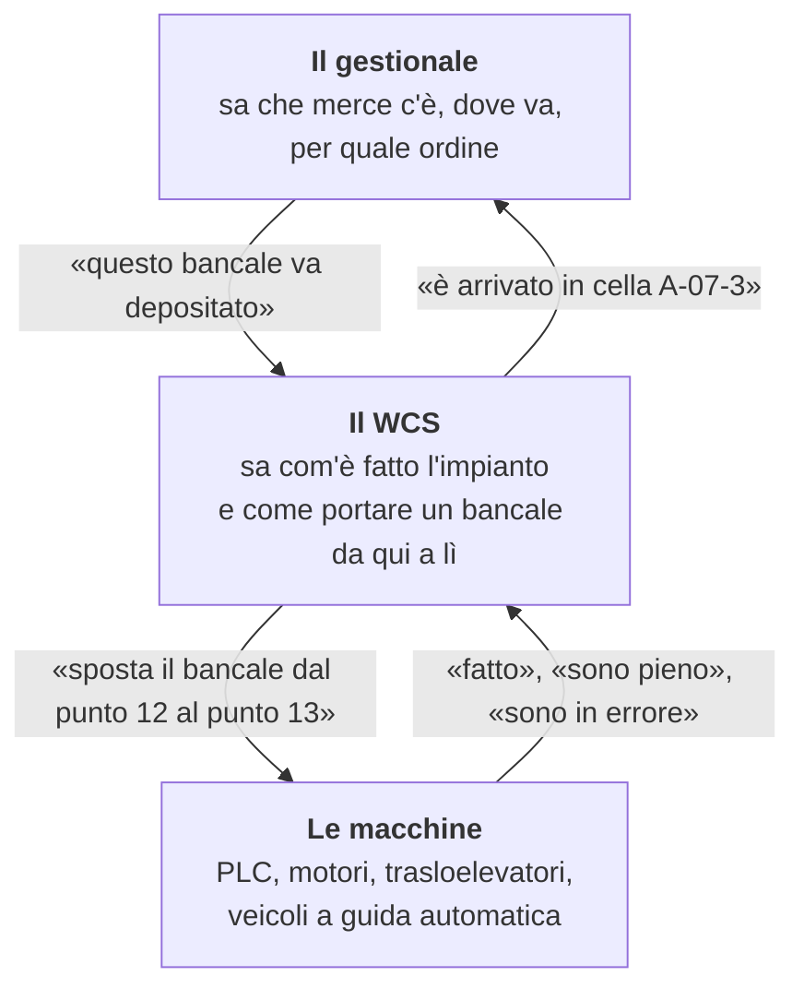

Due idee reggono tutto il resto, e conviene averle in testa prima di aprire un file.

**L'impianto è un disegno, non un programma.** I punti dell'impianto e le frecce che li collegano
sono dati, non codice. Il motore costruisce da quel disegno un grafo e ci calcola sopra le strade.
Aggiungere una rulliera è tirare una freccia nell'Editor, non scrivere un `case` in più.

**La strada nasce un salto alla volta.** Una missione dice «questa unità di carico deve arrivare
là», non per quali tappe. A ogni passo il motore riguarda la situazione del momento e sceglie il
salto successivo. Un dispositivo che va in errore a metà viaggio non lascia in mano al bancale un
piano ormai sbagliato.

Una cosa da sapere prima di leggere il codice, perché spiega molto di come è fatto: **questo
motore ha governato 50 impianti, fino a 386 macchine in contemporanea**. Le regole che lo tengono
coerente sono state raddrizzate dalla realtà, non progettate a tavolino, e questo si vede sia nei
punti in cui il codice è solido sia in quelli in cui è sedimentato. Vale come regola pratica: se
una cosa nel motore sembra strana, è più probabile che risponda a un caso reale che non che sia un
errore.

---

## 2. I pezzi, in quattro gruppi

L'area `WCS/` contiene tredici progetti non di collaudo (diciannove `.csproj` in tutto), più
`Kazam.Wcs`, che dipende solo da qui ma vive nel monorepo del gestionale e non in questo
repository. Si capiscono meglio raggruppati per mestiere.

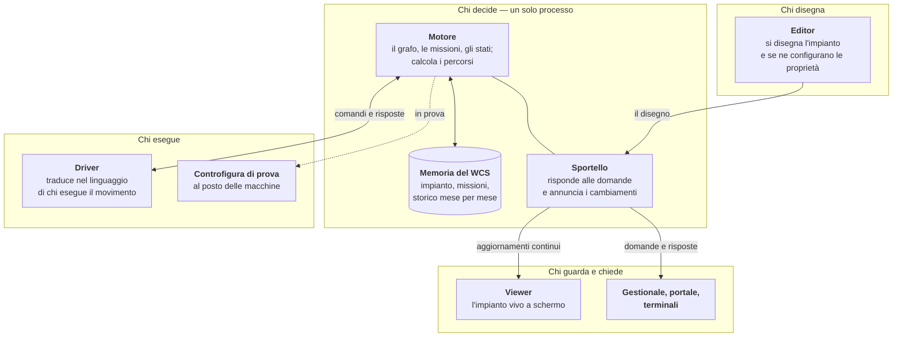

E questi sono i progetti che stanno dietro a quei nomi.

| Progetto | Gruppo | Che cos'è |
|---|---|---|
| `Wcs.Common` | — | il vocabolario condiviso: enumeratori e pochi `EventArgs`. Nessuna logica, nessuno stato: è la foglia di tutta la gerarchia |
| `Wcs.Connection.Interface` | chi esegue | il contratto verso le macchine: l'interfaccia `IConnection` e i tipi dato che vi viaggiano. Nessuna implementazione |
| (il driver dei PLC) | chi esegue | un'implementazione di `IConnection` verso i PLC, collegata all'host con `IConnectionFactory`; quella di Sun Tech non è pubblicata |
| `Wcs.Connection.Test` | chi esegue | la controfigura di prova: nessun socket, nessun database |
| `Wcs.Engine` | chi decide | **il motore.** Il componente più grande dell'area |
| `Wcs.Api.Contracts` | chi decide | i DTO e le rotte: il contratto condiviso fra host e client, senza logica |
| `Wcs.Host` | chi decide | **l'eseguibile di produzione.** Ospita il motore, espone l'API e l'hub degli eventi |
| `Wcs.Api.Client` | chi guarda | il client tipizzato dell'host, con la riconnessione automatica all'hub |
| `Wcs.Viewer` | chi guarda | libreria: tiene una copia in sola lettura dello stato del motore |
| `Wcs.Editor` | chi disegna | l'applicazione con cui si disegna il layout. È un client puro dell'host |
| `Wcs.Wms.Contracts` | chi decide | il contratto verso il gestionale (`IWarehouse`), dichiarato dal WCS. Nessuna dipendenza |
| `Wcs.Wms.Client` | chi decide | la realizzazione HTTP di quel contratto: il solo punto da cui si parla col gestionale |
| `Kazam.Wcs` | chi guarda | la libreria con cui il Client del gestionale parla con l'host. Vive nel monorepo Kazam, non qui |

Due cose vale la pena notare subito, perché sono la sostanza dell'organizzazione.

**Gli eseguibili di esercizio sono due, non tredici.** `Wcs.Host` è l'unico processo di produzione,
e dal 2026-09-03 è l'unico posto in cui il motore gira. `Wcs.Editor` è l'applicazione di disegno,
ed è un client come gli altri. Tutto il resto sono librerie.

**Il motore non ha clienti diretti.** Nessuno, fuori dal processo dell'host, referenzia
`Wcs.Engine`. Editor, Viewer e gestionale passano tutti da `Wcs.Api.Client`, che conosce solo
`Wcs.Api.Contracts`. Se questa regola si rompe, si è rotta l'architettura.

---

## 3. I tre confini

Tutto quello che conta, nel WCS, succede su tre confini. Se hai in testa questi, il resto del
codice si colloca da solo.

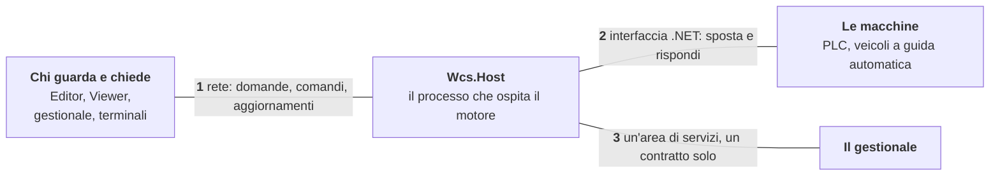

I tre confini non sono fatti della stessa sostanza, e la differenza conta.

| Confine | Che cos'è tecnicamente | Chi lo attraversa |
|---|---|---|
| verso i client | rete: HTTP/JSON per le domande, un hub per gli aggiornamenti | processi diversi, anche su macchine diverse |
| verso le macchine | un'interfaccia .NET, nello stesso processo del motore | il driver, che poi parla come vuole con il campo |
| verso il gestionale | un'interfaccia .NET con due implementazioni, una delle quali usa la rete | l'area di servizi del gestionale |

### 3.1 Verso i client

Nessun cliente del WCS conosce il motore. Tutti conoscono l'host, e ne usano due canali.

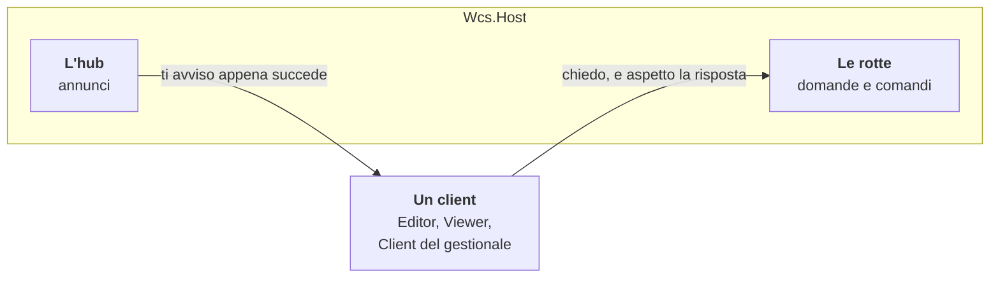

**Il canale delle domande** è un'API HTTP con prefisso `/api/v1`, protetta da una chiave passata
nell'intestazione `X-Api-Key`. Le rotte stanno in otto famiglie, e i nomi dicono già il mestiere
di ciascuna.

| Famiglia | A che serve |
|---|---|
| `/status` | com'è messo il motore adesso |
| `/commands` | mandare comandi e rileggerli |
| `/plant/...` | il disegno, i punti, le frecce, la configurazione, la corrispondenza con le celle |
| `/missions` | le missioni aperte e i loro passi |
| `/extraction-queue` | la coda delle estrazioni, con priorità e cancellazione |
| `/handled-load-units`, `/log` | lo storico e il registro |
| `/plc/connections` | l'elenco delle connessioni al campo e il loro stato |
| `/wms/...` | le letture del gestionale che il motore serve ai suoi client |

**Il canale degli annunci** è un hub sul percorso `/hub/plant`: il client si iscrive una volta e
l'host gli manda gli eventi nel momento in cui accadono, senza che debba interrogare. Sono sei.

| Annuncio | Quando arriva |
|---|---|
| `ItemStatusChanged` | un punto dell'impianto ha cambiato stato |
| `NavigatorStatusChanged` | il motore ha cambiato stato |
| `MissionChanged` | una missione è nata, si è spostata, è cambiata o è finita |
| `ExtractionQueueChanged` | la coda delle estrazioni è cambiata |
| `CommandChanged` | un comando è avanzato |
| `Watchdog` | periodicamente, per dire che il canale è vivo |

Tre dettagli che si scoprono sempre nel modo peggiore, quindi meglio dirli qui.

- **La chiave viaggia nell'intestazione, ma l'hub la accetta anche in query string.** È
  deliberato: il client SignalR del browser non può impostare intestazioni sul canale di
  trasporto.
- **`/openapi` è l'unico percorso esente dalla chiave.** Tutto il resto risponde `401`.
- **L'hub notifica, non è la fonte di verità.** Un client che perde la connessione e la riprende
  deve rileggere lo stato dalle rotte, non presumere di avere ancora la fotografia giusta.

### 3.2 Verso le macchine

Fra il motore e chi esegue davvero il movimento c'è un'interfaccia dichiarata, `IConnection`. È la
parte dell'architettura che rende il sistema indipendente dal tipo di impianto, quindi merita
attenzione anche da chi non lavorerà mai su un driver.

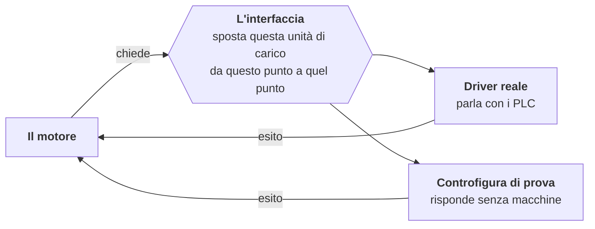

Il modo di chiedere è deliberatamente povero. Da una parte i metodi, cioè quello che il motore
chiede; dall'altra gli eventi, cioè quello che il campo racconta.

| Il motore chiede | Che cosa vuol dire |
|---|---|
| sposta questa unità di carico da questo punto a quel punto | il comando fondamentale; esiste anche nella forma «sposta questo gruppo di unità insieme» |
| dammi i dati dell'unità di carico che hai lì | il campo ha letto qualcosa e il motore vuole i dettagli |
| prendi i dati di questa unità di carico | il verso opposto: è il motore a dirli al campo |
| mostra questo messaggio | testo verso l'operatore, sul posto |
| manda questo comando con questi parametri | via di servizio generica, oggi senza chiamanti |
| apri, chiudi, rilascia la connessione | il ciclo di vita del collegamento |

| Il campo racconta | Che cosa vuol dire |
|---|---|
| è arrivata una nuova unità di carico su questo punto | il campo ha visto qualcosa che il motore non aveva messo lì |
| il movimento è finito | l'esito del comando, con le posizioni finali |
| l'unità di carico è uscita da questo punto | scaricamento |
| ti chiedo i dati di un'unità di carico | il campo interroga il motore |
| ti mando i dati di un'unità di carico | il campo risponde |
| è successo questo, con questi parametri | il canale degli eventi generici |

Nell'interfaccia non compaiono indirizzi di memoria né telegrammi: compaiono punti dell'impianto,
unità di carico ed esiti. Un punto è un indirizzo **logico**, tre stringhe che il driver sa
tradurre nel proprio mondo.

Da qui discende il modo di mettere in campo una macchina nuova. **Il driver di una macchina si
scrive rispettando quell'interfaccia**: parla il linguaggio del costruttore da un lato e
l'interfaccia del WCS dall'altro. Il motore non sa e non deve sapere chi ci sia dall'altra parte,
quindi non cambia; non cambia nemmeno il disegno dell'impianto. Per il WCS, una flotta di veicoli
a guida automatica è un esecutore come un altro.

Le implementazioni nel repository sono due: una verso i PLC e la controfigura di prova, che
risponde senza macchine. Su entrambe conviene avere le aspettative giuste. **Il driver di un
impianto si scrive contro l'interfaccia**, non derivandolo da un'implementazione esistente. E la
controfigura è deliberatamente minima, perché solleva solo una parte degli eventi: serve alle
prove di configurazione, non come banco di collaudo completo.

### 3.3 Verso il gestionale

Il gestionale non parla con il WCS quando gli pare e non ne legge le tabelle. Passa da un'unica
area di servizi, e quell'area è l'unico punto del gestionale che conosca l'esistenza del WCS.

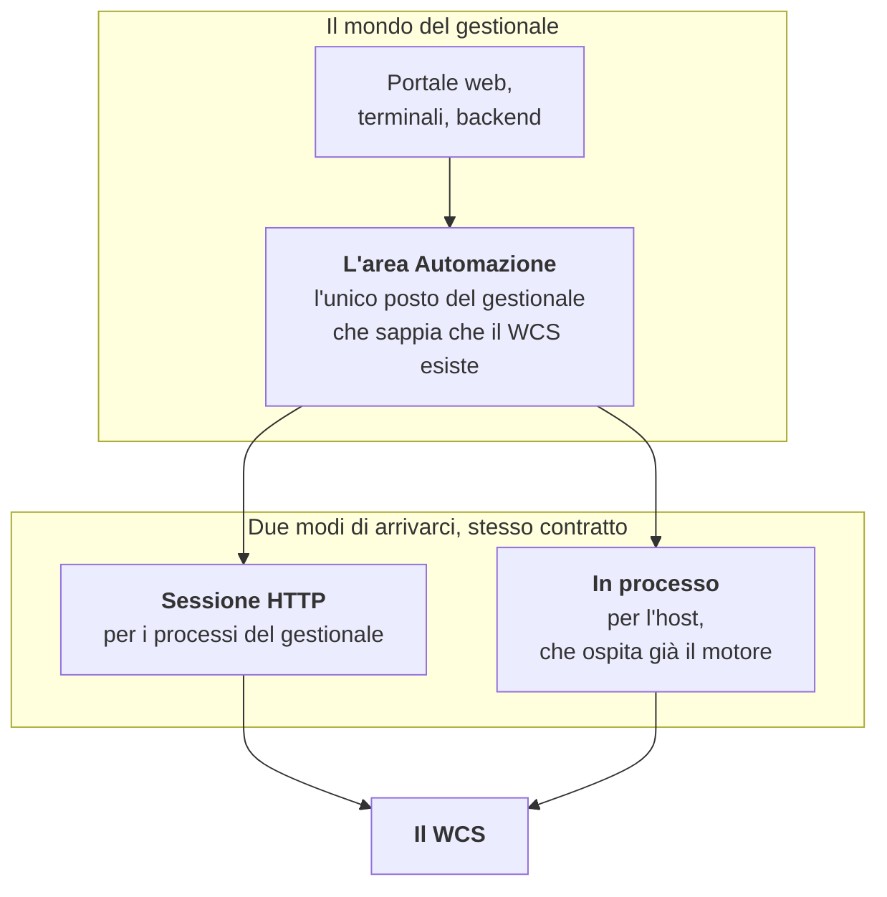

Il contratto è un'interfaccia con otto metodi: sette domande brevi e una traccia.

| Domanda | A che serve |
|---|---|
| questa unità di carico è in missione? | non farci sopra operazioni che il WCS sta già eseguendo |
| questa lavorazione ha prelievi in corso? | la stessa guardia, dal lato della lavorazione |
| questa estrazione ha prelievi? | idem, per le estrazioni per unità di carico |
| questa unità di carico è in coda di estrazione? | la coda è del WCS, non del gestionale |
| quali celle sono servite dall'automazione? | la ricerca celle deve saperlo |
| quale punto dell'impianto serve questa cella? | la corrispondenza fra celle e porte |
| dammi il contesto della ricerca celle | una sola chiamata composita invece di tre |
| registra questa traccia | quello che un'utilità ha fatto, a miglior sforzo |

Due regole di questo confine sono la cosa più facile da sbagliare.

**Chi ospita il motore non chiama se stesso via rete.** L'host costruisce un'implementazione **in
processo** dello stesso contratto, appoggiata direttamente alle facciate del motore. La sessione
HTTP è per i processi del gestionale, non per l'host.

**«L'impianto ha automazione» è un parametro del gestionale**, non una deduzione. Se il parametro
dice di no, le domande all'area rispondono senza cercare nessun host. Se dice di sì e non c'è modo
di raggiungere il WCS, si solleva un errore: **mai un filtro spento in silenzio**, perché un
filtro spento in silenzio produce risposte sbagliate che sembrano giuste.

C'è un dialogo anche nell'altro verso — il motore, per fare il proprio mestiere, ha bisogno di
sapere della merce, delle celle e delle lavorazioni — e fino al 2026-09-12 quella metà del confine
non era chiusa: il motore apriva SQL Server del gestionale e ne leggeva le tabelle con SQL scritto
dentro di sé. Adesso **passa anche lei da un contratto**, `IWarehouse`, dichiarato dal WCS e
realizzato via HTTP da `Wcs.Wms.Client`. Sotto `WCS/Wcs.Engine/src` non c'è più un'istruzione T-SQL,
e un test lo tiene chiuso.

---

## 4. Il modello del motore

Il motore tiene tutto in memoria e lo rispecchia sul proprio database. Quattro concetti bastano
per orientarsi.

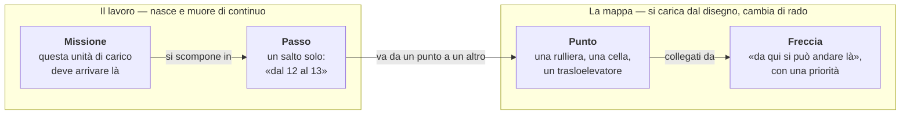

| Nello schema | Nel codice | Le proprietà che contano |
|---|---|---|
| punto | `AutomationDevice` | identificatore, nome, tipo, stato, l'indirizzo logico verso il campo, la connessione, il gruppo, l'unità di carico che ci sta sopra |
| freccia | `AutomationJunction` | identificatore, punto di partenza, punto di arrivo, priorità |
| missione | `PathMission` | identificatore, stato, tipo, punto di partenza, destinazione, **posizione attuale**, unità di carico, i passi |
| passo | `MissionStep` | identificatore, da quale punto, a quale punto, la missione, chi lo sta eseguendo, l'esito, inizio e fine |

La mappa è un grafo: i punti sono i nodi, le frecce gli archi. Il lavoro sta sopra: una missione è
l'obiettivo, un passo è il singolo salto che viene chiesto alle macchine. La missione **non
contiene** la strada: contiene dove si trova adesso e dove deve arrivare, e la strada si
ricostruisce quando serve. La ricerca vera e propria sta in `PathBuilder`, che si costruisce
attorno a una missione e restituisce la lista dei passi.

---

## 5. I tre cicli che tengono vivo il motore

Il motore non ha un `Main`. Si avvia assegnando la stringa di connessione, e da lì partono tre
cicli indipendenti che girano finché il motore vive. Chi arriva sul progetto e si chiede «ma chi è
che fa partire le cose?», la risposta è qui.

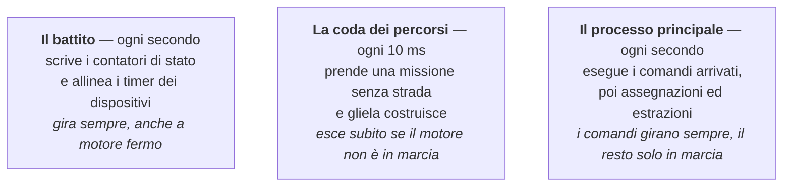

Sono tre cicli avviati e non attesi: ciascuno è un `while` che esegue il proprio corpo e poi
aspetta. La cadenza è la pausa **fra una fine e l'inizio successivo**, non un periodo fisso: se il
corpo dura più della pausa, il ciclo rallenta invece di accavallarsi.

Due conseguenze che vale la pena sapere prima di leggerne il codice. La prima è che il motore si
avvia da un **effetto collaterale**: il setter della stringa di connessione lancia il caricamento
in un compito scartato, quindi chi lo assegna non ha modo di sapere quando il caricamento è
finito, né se è fallito. La seconda è che gli errori di quel caricamento finiscono solo nel
registro. Sono due difetti noti, non due esempi da imitare.

---

## 6. Che cosa succede quando un bancale si muove

Questo è il giro completo, da estremo a estremo. Serve a mettere in fila i pezzi visti finora.

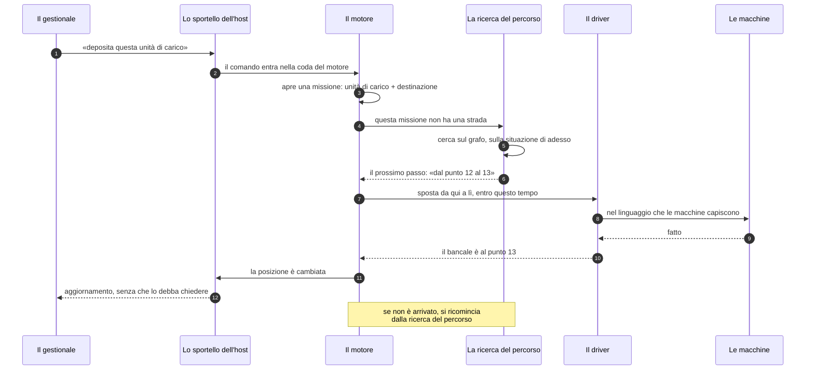

Il punto da capire è il ciclo in fondo: **il giro dalla ricerca del percorso al ritorno dal campo
si ripete a ogni salto**, e ogni volta la ricerca riparte dalla situazione di quel momento. Non
esiste da nessuna parte un elenco delle tappe deciso all'inizio.

---

## 7. Come sceglie la strada

Il criterio ha due gradini, ed è dichiarato.

1. **Vince la strada con meno passaggi.**
2. Fra le più corte, **vince la meno affollata**: quella che attraversa i punti con meno movimenti
   già in attesa.

La priorità che si assegna alle frecce nel disegno decide in quale ordine il motore esplora le
strade, e quindi quale sceglie quando anche l'attesa è pari: è il modo con cui chi conosce
l'impianto indica la via preferita.

**Non si usano tempi stimati, ed è una scelta.** Il motore ragiona su ciò che conosce con certezza
— quanti punti si attraversano, quali sono liberi, quanti movimenti sono già in coda — e non su
durate che dipendono da carico, velocità e usura. Un costo basato sui tempi resta un'opzione
futura, non un pezzo mancante.

La ricerca tiene conto anche di tre vincoli che l'impianto reale impone: si può **imporre a una
missione di passare per un punto**, e allora le strade che non ci passano cadono; i **gruppi** di
punti che lavorano come un blocco unico si attraversano una volta sola; i **punti fuori linea** si
evitano, ma se non esiste nessuna strada senza di loro il motore riprova considerandoli, così un
impianto degradato continua a lavorare invece di fermarsi.

---

## 8. La memoria del WCS

Il WCS conserva i propri dati per conto proprio, in file suoi che vivono accanto al servizio.
Nessuna delle sue tabelle sta nel database del gestionale.

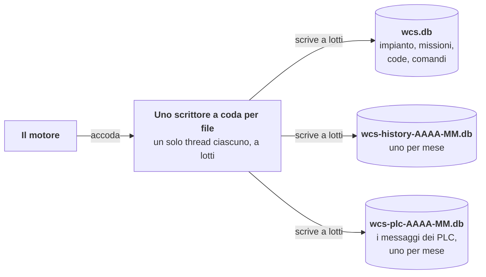

Tre cose da sapere.

**Un solo scrittore per file.** Le scritture non partono dai thread che generano gli eventi:
vengono accodate e le esegue un thread solo, a lotti. Le code si comportano in modo diverso quando
si riempiono, ed è deliberato: quella dello storico e quella dei messaggi dei PLC scartano le voci
vecchie, quella dello stato fa aspettare chi scrive. Storico e messaggi dei PLC hanno due file e
due code proprio perché lo scarto non distingue: con una coda sola, un'ondata di telegrammi faceva
cadere le righe del navigatore (voce `D183`).

**Lo storico è diviso per mese**, un file per mese, e si tiene per il numero di mesi che si
configura. Chi importa uno storico vecchio deve alzare quel numero **prima** del primo avvio,
altrimenti la ritenzione cancella i mesi appena importati.

**Il database è SQLite**, e il provider è cablato: PostgreSQL non è implementato, per quanto la
struttura non lo impedisca. I test del motore girano su SQLite in memoria, ed è il motivo per cui
la suite è veloce e non chiede nulla all'ambiente.

---

## 9. Il primo avvio

Qui si mettono le mani. L'ordine conta.

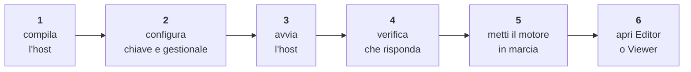

**1. Compilare.** Serve l'SDK di .NET 10. (Nel repository interno `Common` e' un submodule da inizializzare, e senza si ottengono errori di tipi mancanti che sembrano pacchetti NuGet; in questo repository e' una cartella normale.) Il filtro di
soluzione dell'area funziona, ma l'abitudine qui è compilare il singolo progetto: è più veloce e
dice meglio che cosa si è rotto.

```bash
dotnet build WCS/Wcs.Host/src/Wcs.Host.csproj -v q --nologo
```

**2. Configurare.** L'host legge la propria configurazione dalla sezione `Wcs:`, e in più
l'indirizzo e la chiave dell'API del gestionale nella sezione `Wms:`. Le chiavi che contano davvero
al primo avvio sono poche.

| Chiave | Predefinito | A che serve |
|---|---|---|
| `Wcs:ApiKey` | vuota | la chiave completa dell'intestazione `X-Api-Key`, per Editor e integrazioni che scrivono. **Senza, o lasciata al segnaposto, l'host non parte**: è deliberato |
| `Wcs:ReadOnlyApiKey` | vuota | chiave facoltativa distinta per Viewer e monitoraggio: permette `GET`, `HEAD` e hub, ma una scrittura risponde `403` |
| `Wcs:AllowInsecureRemoteHttp` | `false` | consente esplicitamente l'ascolto HTTP fuori dal loopback. Solo per una LAN d'impianto segregata: non cifra niente e genera un log `Critical` |
| `Wms:ApiAddress` | `http://localhost:5142` | l'origine dell'API del gestionale (schema, nome e porta, senza percorso): è il confine da cui il motore prende il magazzino. Obbligatoria con `Wcs:StartEngine` a `true` |
| `Wms:ApiKey` | vuota | la chiave verso il gestionale, la stessa di `WcsWarehouse:ApiKey` in `WMS.Services.API`. **Senza, o lasciata al segnaposto, l'host non parte** |
| `Wms:TimeoutSeconds` | `30` | il tetto di una chiamata al gestionale; sotto `5` l'host non parte, perché sarebbe un refuso e non una politica |
| `Wcs:DatabaseDirectory` | `Data` | dove finiscono i file SQLite del WCS; se è relativa, si risolve accanto all'eseguibile |
| `Wcs:HistoryMonthsToKeep` | `12` | quanti mesi di storico restano in linea. Da alzare **prima** del primo avvio se si importa uno storico vecchio |
| `Wcs:StartEngine` | `true` | a `false` l'host espone l'API senza avviare il motore: è così che girano i test |
| `Wcs:AutoRun` | `false` | a `true` il motore va in marcia da solo, e quindi apre le connessioni al campo |

Le chiavi non vanno messe in `appsettings.json`, che nel repository contiene solo un segnaposto:
in sviluppo si usano gli user secrets del progetto, in esercizio le variabili d'ambiente
(`Wcs__ApiKey`, `Wcs__ReadOnlyApiKey`, `Wms__ApiKey`). Viewer e monitoraggio ricevono
`Wcs__ReadOnlyApiKey`; Editor e integrazioni che devono scrivere ricevono `Wcs__ApiKey`. Le altre
chiavi della sezione `Wcs:Engine:` sono parametri di comportamento del motore e al primo avvio si
lasciano come sono.

**`Wms:ConnectionString` non si legge più.** Fino al 2026-09-12 il motore apriva SQL Server del
gestionale e quella chiave era obbligatoria; adesso non la legge nessuno. Se un'installazione vecchia
se la porta dietro — nell'`appsettings.json`, in un `appsettings.Secrets.json` non tracciato accanto
all'eseguibile, o in una variabile d'ambiente — **viene semplicemente ignorata**: non fa partire
niente e non impedisce niente. Si può togliere con calma; quello che serve davvero è la coppia
`Wms:ApiAddress` + `Wms:ApiKey`.

**3. Avviare.** Per uso locale non serve cambiare Kestrel: il predefinito è
`http://127.0.0.1:5580`, raggiungibile soltanto dalla stessa macchina.

Per esporre direttamente l'host in rete, configurare HTTPS con un certificato installato e
gestito dall'impianto:

```json
"Kestrel": {
  "Endpoints": {
    "Https": {
      "Url": "https://0.0.0.0:5580",
      "Certificate": { "Path": "wcs.pfx", "Password": "dal-secret-store" }
    }
  }
}
```

La password reale va nel secret store o nella sorgente di configurazione protetta scelta per
l'installazione, non nel file tracciato. Il `BaseAddress` dei client deve usare `https://` e il
certificato deve essere considerato valido dalle macchine client.

Con un reverse proxy locale, il proxy termina TLS e inoltra verso
`http://127.0.0.1:5580`: Kestrel resta sul loopback e non deve essere aperto alla LAN. Esporre
l'host direttamente in HTTP è ammesso soltanto su una LAN d'impianto segregata, con consenso
esplicito, per esempio:

```powershell
$env:Wcs__AllowInsecureRemoteHttp = 'true'
dotnet Wcs.Host.dll --Kestrel:Endpoints:Http:Url http://0.0.0.0:5580
```

`Wcs__AllowInsecureRemoteHttp=true` non cifra niente: chi può intercettare `X-Api-Key` può
riutilizzarla. L'host scrive per questo un evento `Critical`; senza l'opt-in rifiuta di avviarsi
su un endpoint HTTP non loopback.

**4. Verificare.** Una `GET` su `/api/v1/status` con l'intestazione della chiave deve rispondere.
Se torna `401` la chiave non coincide; se non risponde affatto, l'host non è partito e il motivo è
nel suo registro, quasi sempre una chiave mancante o lasciata al segnaposto. Un gestionale
irraggiungibile, invece, **non** impedisce l'avvio: l'host parte lo stesso, `/api/v1/status` dice
che il motore non è caricato e perché, e il caricamento si ritenta da solo (voce `D145`).

**5. Mettere il motore in marcia.** Con `Wcs:AutoRun` a `false`, che è il predefinito, dopo
l'avvio il motore ha caricato l'impianto ma non sta lavorando: non apre le connessioni al campo e
il ciclo dei percorsi esce subito. Lo si porta in marcia con un comando, dal Client del gestionale
o dall'API.

**6. Aprire Editor o Viewer.** Sono client: chiedono l'indirizzo dell'host e la chiave. Da qui in
avanti quello che si vede a schermo arriva dall'hub.

**La demo.** Gli script che nel repository interno salvano e ripristinano un ambiente di prova completo non sono pubblicati: ripristinano un backup del gestionale che fuori da Sun Tech non esiste.

---

## 10. Le suite di collaudo

**Sette** suite riguardano il WCS, e non stanno tutte nella stessa cartella: cinque in questo
repository, due nel monorepo del gestionale.

| Suite | Dove | Che cosa copre | Test |
|---|---|---|---|
| `Wcs.Engine.Test` | qui | il motore: grafo, missioni, percorsi, persistenza su SQLite in memoria | 430 |
| `Wcs.Host.Test` | qui | le rotte, l'hub, la sicurezza, l'host in memoria | 76 |
| `Wcs.Wms.Client.Test` | qui | `HttpWarehouse`, cioè il confine dal lato del WCS | 32 |
| `Wcs.Wms.Contracts.Test` | qui | il contratto `IWarehouse` e le sue rotte | 2 |
| `Wcs.Api.Client.Test` | qui | il client tipizzato, sull'host in memoria dell'altra suite | 8 |
| `Kazam.Wcs.Test` | Kazam | la libreria con cui il Client del gestionale parla con l'host | 28 |
| `WMS.Services.Test` | Kazam | l'area `Automazione`, cioè il confine dal lato del gestionale | 131 |

**I numeri sono una misura, non una proprietà**: sono quelli dell'ultima esecuzione del
2026-09-10 (le cinque di qui a `2905cd3`, `WMS.Services.Test` dopo `bcb2eb7e` in Kazam), e ogni
ondata di riparazioni li muove — i collaudi aggiunti dopo quella misura non sono contati. Prima di
citarli, si rimisurano.

Tre avvertenze pratiche. La prima: **tre di queste suite ricompilano l'host**, quindi se
l'eseguibile è in esecuzione la copia fallisce e si finisce per collaudare il binario di prima. La
seconda: `Wcs.Viewer.Test` non è una suite nonostante il nome e la posizione, è l'applicazione
dimostrativa del Viewer. La terza, dal 2026-09-10: `WMS.Services.Test` non è più una suite di soli
collaudi in memoria — tre dei suoi test creano e distruggono un database su un SQL Server locale, e
su una macchina che non ce l'ha falliscono invece di essere saltati.

L'Editor non ha test automatici: si collauda a video.

---

## 11. Sei cose che sorprendono chi arriva

Non sono curiosità: sono le convinzioni sbagliate che costano più tempo.

**Il motore è uno solo per processo, e i suoi membri sono statici.** Non si istanzia un motore: lo
si configura. Ne discende che due motori nello stesso processo non esistono, e che un test che non
ripulisce lo stato lo lascia al test successivo.

**Il motore si avviava da un effetto collaterale, e per un pezzo è stato l'unico modo.** Oggi il
metodo c'è, `Navigator.StartAsync(connectionString)`
(Navigator.cs:719 «public static async Task<bool> StartAsync(string connectionString)»),
restituisce l'esito e lo chiama l'host all'avvio. Il vecchio ramo non c'è più: il setter di
`Navigator.DatabaseConnectionString`, che faceva partire il caricamento in un compito che nessuno
attendeva, è stato cancellato l'11 settembre 2026 (voce `B9` del registro del debito) e la
proprietà è in sola lettura. Chi avvia il motore usa `StartAsync`, e non c'è un'altra via.

**Lo stato di errore di un dispositivo è logico, non un allarme di campo.** Significa «l'ultimo
comando non è passato», e se ne esce riprovando. Chi lo legge come un guasto della macchina cerca
il difetto nel posto sbagliato.

**Non c'è un thread per dispositivo.** I dispositivi non hanno un proprio filo di esecuzione: i
difetti di concorrenza stanno nelle sequenze e nelle decisioni, non nei contenitori. Mettere un
lucchetto attorno a una collezione, di solito, non risolve niente.

**Una build fallita lascia in giro il binario di prima.** Se l'applicazione è aperta, la copia
della libreria non riesce e si collauda il codice precedente credendo di provare il nuovo.
Chiudere l'applicazione, ricompilare, e guardare la data del file.

**Gli identificatori nuovi si scrivono in inglese.** Commenti, documentazione e messaggi di commit
restano in italiano; i nomi nel codice no. È la regola, e va detto che il codice non la rispetta
dappertutto: restano undici classi di prova e alcuni locali scritti in italiano proprio in questo
piano, ed è la voce `D134` del registro del debito.

---

## 12. Dove si continua a leggere

In quest'ordine, secondo che cosa devi fare.

- **Capire meglio l'idea, senza codice**: [come-funziona.md](come-funziona.md).
- **Sapere chi dipende da chi, con le righe verificate**: README.md (non pubblicato), sezione
  «Dipendenze», e i tre flussi che seguono, disegnati con i tipi reali.
- **Mettere le mani su un componente**: il suo `doc/architettura.md`. Quello del motore è il più
  lungo dell'area e va letto per sezioni, non di seguito.
- **Toccare la persistenza**: [database-del-wcs.md](database-del-wcs.md).
- **Prima di stupirti di qualcosa**: debito-tecnico.md (non pubblicato). Se una stranezza è
  già nota è lì, con una stima del costo per ripararla.

Un'ultima cosa sul metodo, perché cambia come si legge tutto il resto. La documentazione di
quest'area **cita il codice riga per riga**, e uno strumento verifica che le righe citate esistano
ancora. Questo rende i documenti attendibili sulle citazioni, non sulle affermazioni: una riga può
esistere e la frase che la commenta essere comunque invecchiata. Quando una cosa conta, si apre il
file.
