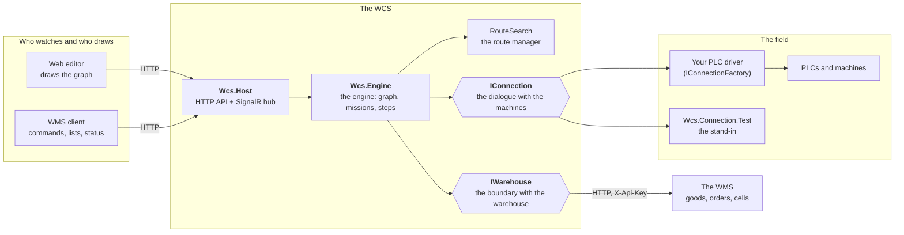
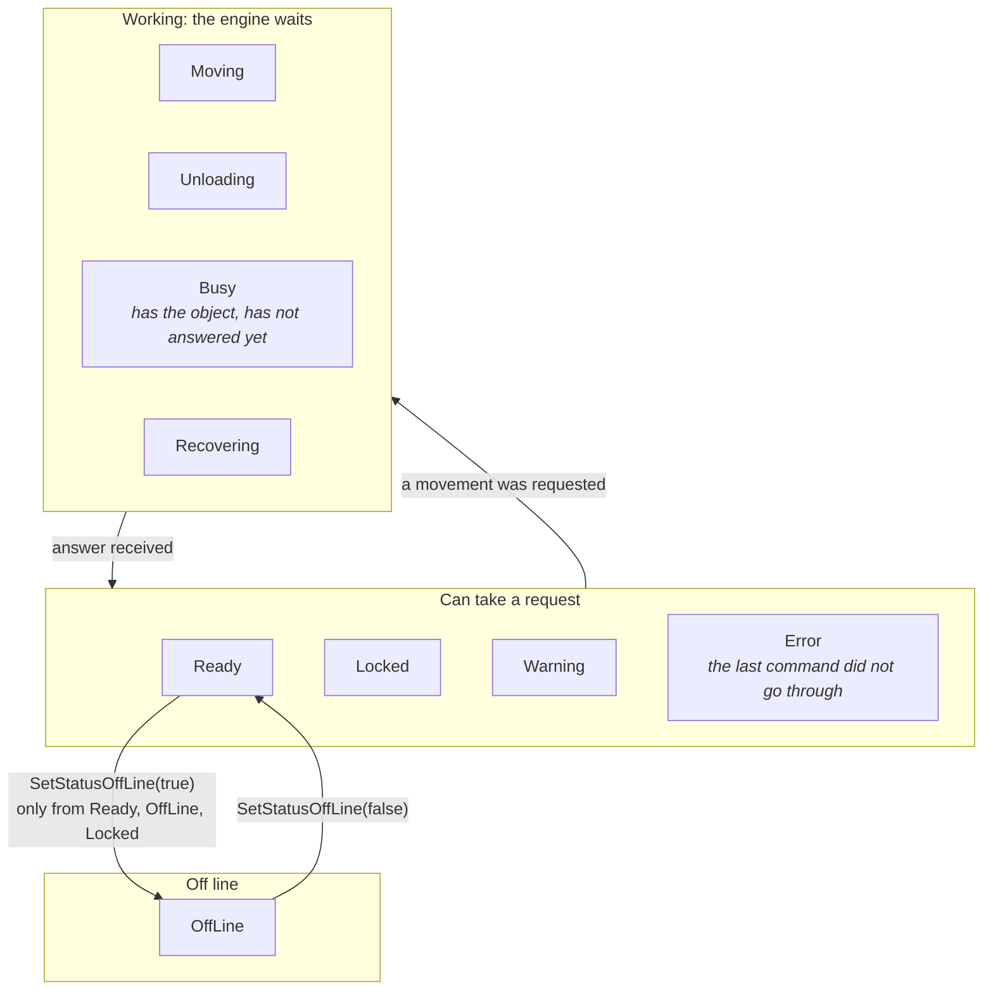
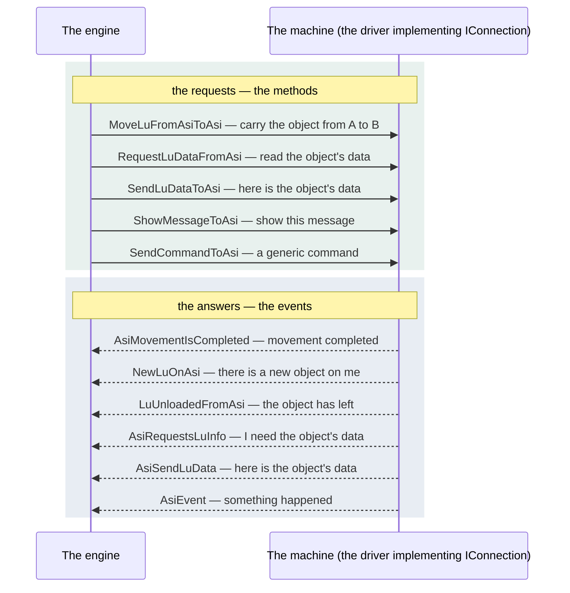
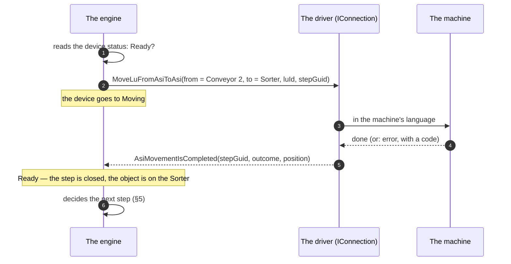
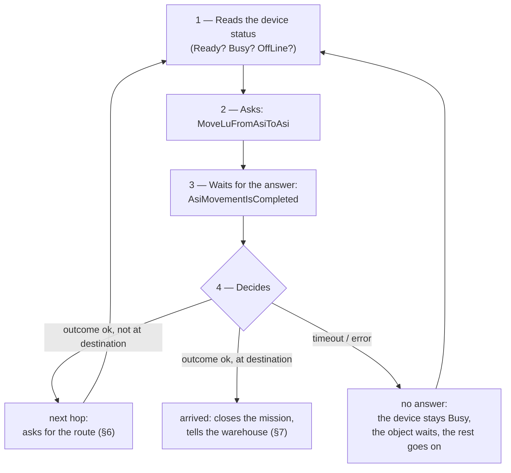
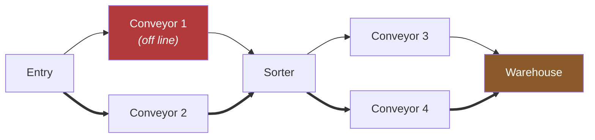
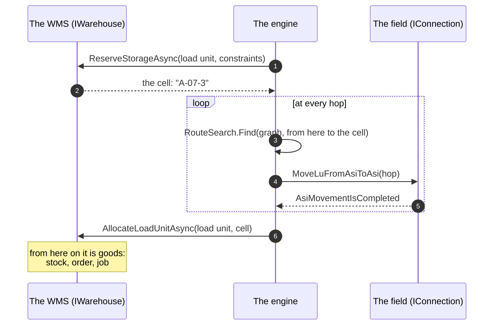
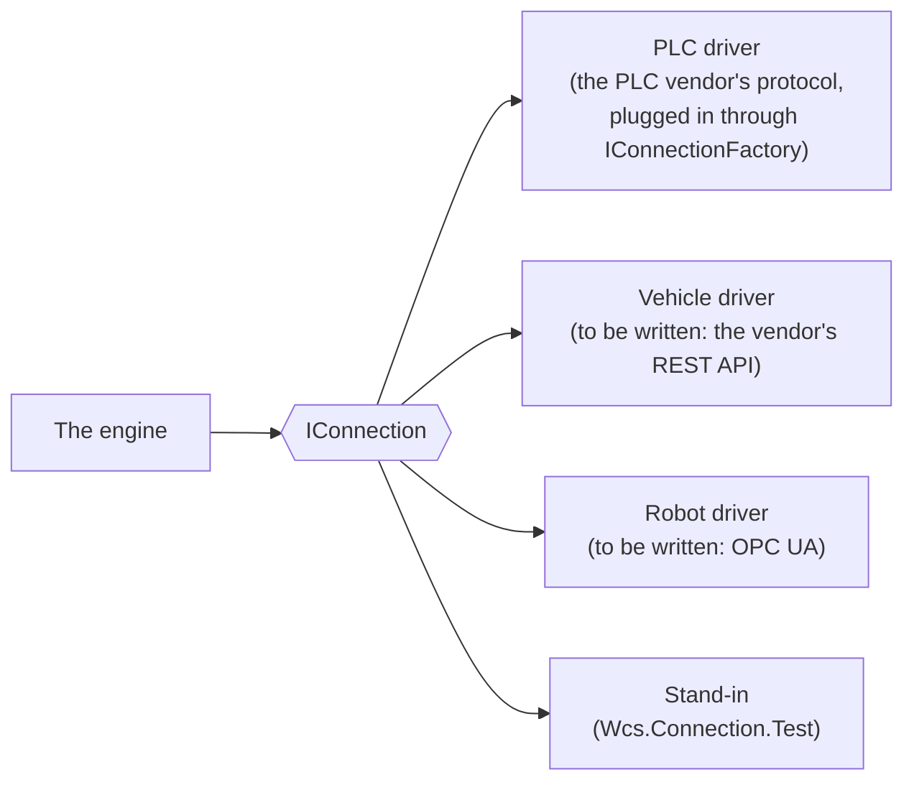

# How the WCS thinks — for programmers

This document explains **how the WCS reasons**, starting from the idea it was born from and
ending with the names in the code: the interfaces, the enumerations, the signatures. It is
written for a programmer who needs to understand the product before touching it — or who has
to **write the driver for a new machine** and wants to know what the WCS expects from it.

It is not a step-by-step guide: the guides for whoever puts the WCS under a WMS, with runnable
examples, are [the integration guides](README.md), and the driver contract is told in
full in [Connecting machines](integration/connecting-machines.md). It is the *why*
document: once you have read it, the rest of the code has an order. Paths are written from the
root of the repository.

The examples are made up: names such as "Conveyor 2" or "Sorter" do not correspond to any real
plant.

## 1. The idea, and its translation into code

Picture a line of people passing objects along. Each one receives an object from the person
before, does their part, and passes it to the person after. **Nobody sees the whole line**: each
one only knows what they are holding and who to hand it to. Each has a logic of their own — one
can only pass things forward, one chooses between two exits, one puts things away and goes to
fetch them — and that logic is not decided by the coordinator: it is decided by the machine and by
the software that runs it.

The WCS is the one who coordinates the line. It does not drive the motors: it **asks** each one to
do something it knows how to do ("take", "unload", "carry from A to B", "read the data"), **waits**
for the answer about how it went, and **decides** the next step. And it does not invent the route:
at every step, the object asks for it from the one who knows the map.

Every piece of the metaphor has a name in the code.

| In the line | In the WCS | Where |
|---|---|---|
| A person in the line | a **device** (`AutomationDevice`), with a type and a status | `WCS/Wcs.Engine/src/Items/` |
| What it can do | the device **type**: `DeviceTypes` | `WCS/Wcs.Common/src/Enums.cs` |
| How it is doing right now | the device **status**: `DeviceStatusTypes` | `WCS/Wcs.Common/src/Enums.cs` |
| The object passed from hand to hand | the **load unit** (LU: a pallet, a tote) | `AutomationDevice.LoadedLu`, `luId` in `IConnection` |
| The line, with its forks | the **plant graph**: a `RouteGraph` of `RouteNode`s and `RouteEdge`s | `WCS/Wcs.Engine/src/Routing/RouteGraph.cs` |
| The coordinator | the **engine** (`Wcs.Engine`, the *Navigator*) | `WCS/Wcs.Engine/src/Navigator.cs` |
| The one who knows the map | the **route manager**: `RouteSearch.Find` | `WCS/Wcs.Engine/src/Routing/RouteSearch.cs` |
| The dialogue with each person | the **`IConnection`** interface: eight methods, six events | `WCS/Wcs.Connection.Interface/src/IConnection.cs` |
| The machine and its software | the PLC and the **driver** that implements `IConnection` | `Wcs.Connection.Test` (the loopback driver), or your own driver through `IConnectionFactory` |
| An object's journey | a **mission** (`PathMission`) made of **steps** (`MissionStep`) | `WCS/Wcs.Engine/src/Items/` |
| The warehouse, which reasons about goods | the WMS behind the **`IWarehouse`** contract | `WCS/Wcs.Wms.Contracts/src/IWarehouse.cs` |

## 2. The components, and who talks to whom



Three things to pin down right away.

1. **The engine runs in a single process, the host.** The web editor and the WMS client are pure
   clients: they talk to the host's API and receive statuses from the hub (the web editor is
   served by the host, but goes through the same API client). Neither of them drives the engine
   directly.
2. **The engine knows no machine.** It knows `IConnection`. Who is on the other side — a PLC, a fleet of vehicles, a test stand-in — is up to the driver.
3. **The engine knows no WMS.** It knows `IWarehouse`, declared by the WCS itself; the HTTP
   implementation (`HttpWarehouse`) is the only point from which it talks to the warehouse, and the
   host wires it at startup. No WCS project references the WMS projects: a test proves it
   (`EngineDependenciesTest`).

## 3. Each person has their own logic: types and statuses

### 3.1 The type says what it can do

`DeviceTypes` (`WCS/Wcs.Common/src/Enums.cs`) is the machine's capability, the one assigned to the
node in the plant drawing.

| Type | The person in the line who… | Made-up example |
|---|---|---|
| `Automation` | passes forward what it receives | a conveyor, a roller bed |
| `Loading` | is the point where objects enter the line | the entry from a manual area |
| `Buffer` | holds an object until there is room further on | a waiting bay |
| `LoadingAndBuffer` | does both | an entry bay with waiting |
| `Storage` | puts away and goes to fetch | the automated warehouse |
| `CircularDistributor` | chooses between several exits by turning | a rotating sorter |
| `GroupOfAutomationDevices` | a block of people working as one | a shuttle with its transfer points |

The type is not a class per machine: it is an enumeration read from the graph. **One more machine
is one more node in the drawing**, not one more line of code in the engine.

### 3.2 The status says how it is doing right now

The WCS **reads the status before asking**. `DeviceStatusTypes` (`WCS/Wcs.Common/src/Enums.cs`):



Values: `Ready`, `Moving`, `Loading`, `Unloading`, `Busy`, `Recovering`, `OffLine`, `Locked`,
`Warning`, `Error`. The state machine (`AutomationDeviceStateMachine`) **has no transition
table**: any state can follow any other, with only two guards — a device goes off line only from
`Ready`, `OffLine` or `Locked`, and comes back on line only from `OffLine`
(`CanChangeToOfflineState`). What the engine really looks at is the partition above: `Moving`,
`Recovering`, `Unloading` and `Busy` are the states in which **an answer is pending**
(`IsMovementOrBusyState`), and in those it does not ask. Two rules that surprise newcomers:

- **`Error` is a logical state, not a field alarm.** It means "the last command did not go
  through", and you leave it by trying again: from `Error` you go to `Moving` just as from
  `Ready`. There is no reset to perform.
- **A `Storage` never changes state**: it stays `Ready` for the whole life of the process. The
  automated warehouse is handled separately throughout the engine (`OpenConnection` assigns it no
  connection, `ExecuteSteps` skips it).

### 3.3 An object's journey is a mission

A mission (`PathMission`) is a load unit plus a destination, with a type (`MissionTypes`,
`WCS/Wcs.Common/src/Enums.cs`): `Storing`, `Extraction`, `ChangeStoreLocation`, `MovingToItem`
(carry to that point), `StoringByPickUp`, `Rejection`, `PickUpAndStoreAgain`, `DefragmentCell`.
The steps (`MissionStep`) are the single hops from one device to the next, and **they do not all
exist at departure**: they are created one hop at a time, as §5 shows.

## 4. The dialogue: `IConnection`

The contract toward the field is deliberately poor. **Eight methods** are what the engine asks;
**six events** are what the machine reports. The interface contains no memory addresses and no
telegrams: it contains plant points, load units and outcomes.



### 4.1 The requests (the methods)

| Method | What it asks |
|---|---|
| `MoveLuFromAsiToAsi(RunAsi sourceItem, DataAsi actionItemPerformer, DataAsi fromAsi, DataAsi toAsi, Guid stepGuid, decimal luId, int luHandlingMode = 0)` | **the fundamental command**: carry load unit `luId` from `fromAsi` to `toAsi`; `actionItemPerformer` is the one physically performing the movement (it may be neither the origin nor the destination); `stepGuid` correlates the answer to the step |
| `MoveLuFromAsiToAsi(RunAsi sourceItem, DataAsi actionItemPerformer, Guid groupedMovementId, List<MovementLuDataCommand> loadUnitsToMove, int luHandlingMode = 0)` | the same for several units together (a grouped movement) |
| `RequestLuDataFromAsi(RunAsi item)` | read and send me the data of the object you have there |
| `SendLuDataToAsi(RunAsi item, LuInfoDataCommand value)` | the opposite direction: the engine tells the machine the object's data |
| `ShowMessageToAsi(RunAsi destinationItem, string message)` | text for the operator, on the spot |
| `SendCommandToAsi(RunAsi destinationItem, int commandCode, List<string?> parameters)` | a generic service path; no callers in the engine today, but every driver implements it (it is part of the interface) |
| `OpenConnection()`, `CloseConnection()`, `Dispose()` | the life cycle of the link |

Two data types carry everything else:

- **`DataAsi(string? asi, string? subitem, string? partition)`** is the **logical address** of a
  point: three strings the driver knows how to translate into its own world (for a PLC driver
  they may be fields of its telegrams; for other hardware they will be whatever it needs). The engine does
  not interpret them.
- **`RunAsi`** is the identity card of the requesting device: `ItemGuid` (the graph node),
  `TimeOutPeriod`, `DelayToStepDone`, `ErrorResultCode`, `ResultType`. The driver receives it and
  hands it back in the events, so the engine knows who is speaking.

### 4.2 The answers (the events)

| Event | What the machine reports | Data |
|---|---|---|
| `AsiMovementIsCompleted` | the movement is over, with the outcome and the final positions | `AsiMovementIsCompletedEventArgs` |
| `NewLuOnAsi` | there is a new object on me — one the engine did **not** put there | `NewLuOnAsiEventArgs` |
| `LuUnloadedFromAsi` | the object has left me (unloaded) | `LuUnloadedFromAsiEventArgs` |
| `AsiRequestsLuInfo` | I need this object's data | `AsiRequestsLuInfoEventArgs` |
| `AsiSendLuData` | here is the object's data (answer to `RequestLuDataFromAsi`) | `AsiSendLuDataEventArgs` |
| `AsiEvent` | this happened, with these parameters (the generic channel) | `AsiEventEventArgs` |

The delegates live in `WCS/Wcs.Connection.Interface/src/Handlers.cs`; the `EventArgs` in `Events/`,
the data they carry in `ConnectionData/`. The engine subscribes to all six in a single place,
`DeviceConnections` (`WCS/Wcs.Engine/src/Collections/DeviceConnections.cs`).

### 4.3 One hop, from start to finish



The `stepGuid` the engine passes and finds again in the event is **the correlation**: without it,
there is no way to tell which question an answer belongs to. A driver that loses it along the way
breaks the dialogue even when the physical movement went fine.

## 5. Ask, wait for the answer, then decide

The engine has no `Main`. It has **three loops** that run as long as it lives (details in
[per-cominciare.md §5](history/WCS/per-cominciare.md#5-i-tre-cicli-che-tengono-vivo-il-motore), Italian):

| Loop | Cadence | Does |
|---|---|---|
| the heartbeat | every second, always | writes the status counters, aligns the device timers |
| the route queue | every 10 ms, only in `Run` | takes a mission without a route and builds one for it |
| the main process | every second | executes the commands received; then, only in `Run`, assignments and extractions |

The decision cycle for a single object is this, repeated **at every hop**:



Three house rules, which are also the way defects are read.

- **No answer is not silence: it is a fact.** The device stays `Busy` until it speaks, the
  object waits, the engine writes it in its own log. The rest of the line does not stop: the
  route queue works on the other missions.
- **The WCS reports facts, it does not draw consequences.** "The object has arrived in the cell"
  is a fact the WCS tells the warehouse; what follows for the order, the stock, the job is
  decided by the WMS (§7).
- **There is no thread per device.** The engine is not a crowd of workers competing for
  resources: it is a sequence of decisions over shared state. Concurrency defects, when there are
  any, live in the order of the decisions, not in the containers.

## 6. The object asks for the route

The plant is **a map, not a program**: points and links are data drawn in the web editor and saved in
the WCS database, and at runtime they become a `RouteGraph`:

```csharp
public sealed record RouteNode(/* id, type, status, group, … */);
public sealed record RouteEdge(Guid SourceId, Guid DestinationId, int Priority);
public sealed class RouteGraph
{
    public RouteGraph(IEnumerable<RouteNode> nodes, IEnumerable<RouteEdge> edges);
    public RouteNode? Node(Guid id);
    public bool Contains(Guid id);
    public IReadOnlyList<RouteEdge> OutgoingFrom(Guid id);
}
```

The question to the map is a `RouteRequest`, and the answer is a list of hops:

```csharp
public sealed record RouteRequest(
    Guid SourceId,                       // from where
    Guid DestinationId,                  // to where
    Guid GatewayId,                      // a point the route MUST pass through (Guid.Empty if none)
    bool IgnoreItemStatus,               // ignore device statuses (PickUpAndStoreAgain only)
    bool ConsiderOffLineAvailable,       // second pass: accept off-line devices too
    IReadOnlySet<Guid> ItemsToDiscard);  // devices to rule out

public readonly record struct RouteHop(Guid FromId, Guid ToId, int FromGroupRoutePath);

public static IReadOnlyList<RouteHop> Find(RouteGraph graph, RouteRequest request);
```

`RouteSearch.Find` is **pure**: it takes the graph and the question, returns the hops, touches
nothing. It is tested without the engine, without a database, without machines.



The criterion has two steps, and it is declared:

1. **the route with the fewest hops wins**;
2. among the shortest, **the least crowded wins**: the one crossing the points with the fewest
   movements already waiting.

The `Priority` of the edges decides the **exploration order**, and therefore the choice when
crowding is equal too: it is how whoever knows the plant marks the preferred way. **No estimated
times are used**, by choice: the engine reasons on what it knows for certain — how many points,
which are free, how many movements are queued — not on durations that depend on load and wear.

Three more constraints: the **gateway** (a mission can be forced through a point, and routes that
do not pass through it do not count); **groups** (`GroupOfAutomationDevices`) are crossed only
once; **off-line** devices are avoided, but if no route exists without them the caller tries again
with `ConsiderOffLineAvailable = true`, so a degraded plant keeps working instead of stopping.

And the point that changes everything: **the route is asked at every hop**, not at departure. If
Conveyor 1 goes off line while the object is still on the Entry, the next hop avoids it; nowhere
is there a list of stops decided at the start.

## 7. Two trades: the warehouse reasons about goods, the WCS about routes

`IWarehouse` (`WCS/Wcs.Wms.Contracts/src/IWarehouse.cs`) is the boundary with the WMS, declared by the
WCS. Its operations read as four families:

| Family | Examples | Direction |
|---|---|---|
| **questions** about the warehouse | `DescribeCellAsync`, `LocateLoadUnitAsync`, `GetCellBusyStateAsync`, `GetAreaTopologyAsync` | the WCS asks |
| **reservations** | `ReserveStorageAsync`, `GetStorageReservationAsync`, `ReleaseStorageReservationAsync` | the WCS asks for a cell, the warehouse chooses it |
| **ready work** | `GetPendingNoteWorkAsync`, `GetPendingExtractionWorkAsync` | the WCS asks what there is to do |
| **facts** | `AllocateLoadUnitAsync`, `ReleaseLoadUnitAsync`, `ReportExtractionOutcomesAsync`, `ReportMissionServedAssignmentAsync` | the WCS reports how it went |



There is a single failure rule: if the WMS does not answer, `HttpWarehouse` throws
`WarehouseUnavailableException` and the engine treats it as **a fact** — the mission waits, the
host stays alive, it tries again. A 404 is an answer where the contract declares it (for example
`LocateLoadUnitAsync` returning `null`), not an error.

The opposite direction — the WMS telling the WCS "store this", "extract that", "stop" — goes
through the **host API** (`POST /api/v1/commands`, with a `commandType`), not through
`IWarehouse`. The two directions have two contracts.

## 8. Any machine, as long as it speaks the dialogue

This is the practical consequence of the whole document. **The driver for a new machine is
written against `IConnection`**, not derived from the existing driver: it speaks the vendor's
language on one side and the WCS dialogue on the other. The engine does not know, and must not
know, who is on the other side, so it does not change; neither does the plant drawing.



### 8.1 What a driver must do

1. **Implement `IConnection`**: the eight methods and the six events, plus `Id` and `Managed`.
2. **Translate `DataAsi`** into its own addressing. The three strings (`Asi`, `Subitem`,
   `Partition`) are the ones written in the plant drawing for that node: the driver decides what
   they mean to it.
3. **Always answer, and with the correlation.** Every `MoveLuFromAsiToAsi` must be followed by an
   `AsiMovementIsCompleted` with the same `stepGuid`, whether the movement succeeded or not. A
   driver that does not answer leaves the device `Busy`: the engine tolerates it, but the line
   gets shorter.
4. **Report what the engine does not know.** If the machine sees an object the engine did not
   put there, `NewLuOnAsi`; if it loses one, `LuUnloadedFromAsi`. These are the events that keep
   the engine's model aligned with the field.
5. **Do not decide.** The driver does not choose routes, does not know missions, does not talk
   to the warehouse. If it finds itself doing so, it is doing the engine's job.

### 8.2 The skeleton

```csharp
using Wcs.Connection.Interface;
using Wcs.Connection.Interface.CommandData;

public sealed class VehicleFleetConnection(decimal id, IVendorFleetApi fleet) : IConnection
{
    public decimal Id { get; } = id;
    public bool Managed { get; set; }

    public event Handlers.AsiEventEventHandler? AsiEvent;
    public event Handlers.AsiMovementIsCompletedEventHandler? AsiMovementIsCompleted;
    public event Handlers.AsiRequestsLuInfoEventHandler? AsiRequestsLuInfo;
    public event Handlers.AsiSendLuDataEventHandler? AsiSendLuData;
    public event Handlers.LuUnloadedFromAsiEventHandler? LuUnloadedFromAsi;
    public event Handlers.NewLuOnAsiEventHandler? NewLuOnAsi;

    public void OpenConnection() => fleet.Connect(onArrived: RaiseMovementCompleted);
    public void CloseConnection() => fleet.Disconnect();
    public void Dispose() => CloseConnection();

    public void MoveLuFromAsiToAsi(RunAsi sourceItem, DataAsi performer, DataAsi fromAsi, DataAsi toAsi,
        Guid stepGuid, decimal luId, int luHandlingMode = 0)
    {
        // DataAsi.Asi is the station name for the fleet; Subitem and Partition are not needed here.
        fleet.Order(stepGuid, from: fromAsi.Asi, to: toAsi.Asi, payload: luId);
    }

    public void MoveLuFromAsiToAsi(RunAsi sourceItem, DataAsi performer, Guid groupedMovementId,
        List<MovementLuDataCommand> loadUnitsToMove, int luHandlingMode = 0)
        => throw new NotSupportedException("the fleet moves one unit at a time");

    public void RequestLuDataFromAsi(RunAsi item) { /* the fleet reads no labels: no answer is possible */ }
    public void SendLuDataToAsi(RunAsi item, LuInfoDataCommand value) { }
    public void ShowMessageToAsi(RunAsi destinationItem, string message) => fleet.Notify(message);
    public void SendCommandToAsi(RunAsi destinationItem, int commandCode, List<string?> parameters) { }

    private void RaiseMovementCompleted(Guid stepGuid, bool ok, string station)
        => AsiMovementIsCompleted?.Invoke(this, /* AsiMovementIsCompletedEventArgs with stepGuid, outcome, position */ null!);
}
```

The skeleton is deliberately incomplete: the `EventArgs` are built from the data in
`ConnectionData/`, and the loopback driver (`WCS/Wcs.Connection.Test/src/Connection.cs`) shows how two of them are filled. What matters is
the shape: **no routing logic, no warehouse access, one answer for every question**.

### 8.3 Where it hooks in

The engine names no field driver. A driver ships an `IConnectionFactory`
(`WCS/Wcs.Connection.Interface/src/IConnectionFactory.cs`) and the host loads it by reflection from the
`Wcs:ConnectionFactory` setting, an assembly-qualified type name
(`"Namespace.TypeName, AssemblyName"`, with `AssemblyName.dll` in the host folder):
`WCS/Wcs.Host/src/Engine/ConnectionFactoryLoader.cs`. At startup the host hands the factory to
`DeviceConnections.UseConnectionFactory`, which passes it the engine services
(`IConnectionServices`: command identifiers, connection status, navigator log, message log);
when the plant is loaded `DeviceConnections.Initialize` asks the factory one connection per row of
the driver settings the devices point to (`ConnectionSettings`).

The choice per device stays a `switch` on `ConnectionTypes` in `DeviceConnections.OpenConnection`:
`Test` takes the loopback stand-in; `Connected` takes the connection the factory built for the
device's `DeviceConnectionId` (the stand-in, with a warning, when the factory built none for that
row). **Without a factory** a `Connected` device gets no connection at all: it goes `OffLine` and
the navigator log says why, as an error. `Wcs:ConnectionFactory` set to `none` (or empty, in
`appsettings.json`: on Windows an empty environment variable is deleted) means exactly that;
an absent key means the default of the build, which a build that ships a driver names in the host
assembly (`AssemblyMetadata` `Wcs.DefaultConnectionFactory`).

### 8.4 How it is tested

The model is the one of the existing suites: the engine is exercised with a fake `IConnection`
and a fake `IWarehouse` (`FakeWarehouse` in `WCS/Wcs.Wms.Contracts/tests/`), with no database and no
machines. For a new driver the test is the mirror image: call `MoveLuFromAsiToAsi` and check that
an `AsiMovementIsCompleted` arrives with the same `stepGuid`, that an object seen by the field
produces `NewLuOnAsi`, and that `CloseConnection` leaves nothing open. The house rule is **red
test first**: a test that is born green proves nothing.

## 9. What is not pluggable yet: the logic of a device

`IConnection` makes **the way of talking** to a machine replaceable. **The way of reasoning** of a
device is not replaceable yet: the engine has a single class, `AutomationDevice`, and the
difference between a conveyor, a sorter, a buffer and a warehouse lies in an enumeration
(`DeviceTypes`) and in four execution strategies chosen by a `switch`
(`WCS/Wcs.Engine/src/Items/ExecutionStrategies/`). A new person in the line, with a logic of their
own, is today one more `case` in the engine.

Making that logic pluggable too — a base device whose signature the engine declares, today's types
rewritten against it, and new logical entities written in C# in an assembly the host loads — is a
direction the project has declared, not yet specified. Until then, a new machine that behaves
like one of today's types needs only a driver (§8); one that reasons differently needs a change
to the engine.

## 10. Where to keep reading

- [Connecting machines](integration/connecting-machines.md) — the driver contract,
  the loopback driver, a driver of your own, the completion codes.
- [Modelling a plant](integration/plant-modelling.md) — devices, junctions,
  relocators: the graph of §6 as it is drawn.
- [The WMS contract](integration/wms-contract.md) — `IWarehouse` of §7, route by
  route, as it travels on the wire.

Sun Tech's internal design notes, in Italian, kept for reference as they were written (not current):

- [per-cominciare.md](history/WCS/per-cominciare.md) — the guide for newcomers: startup, test suites,
  surprises.
- [database-del-wcs.md](history/WCS/database-del-wcs.md) — what the WCS keeps in its own memory.
