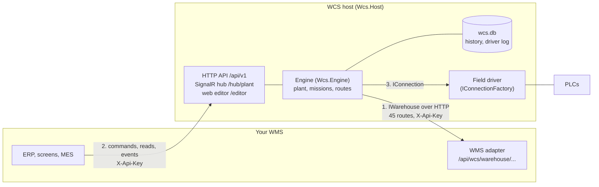
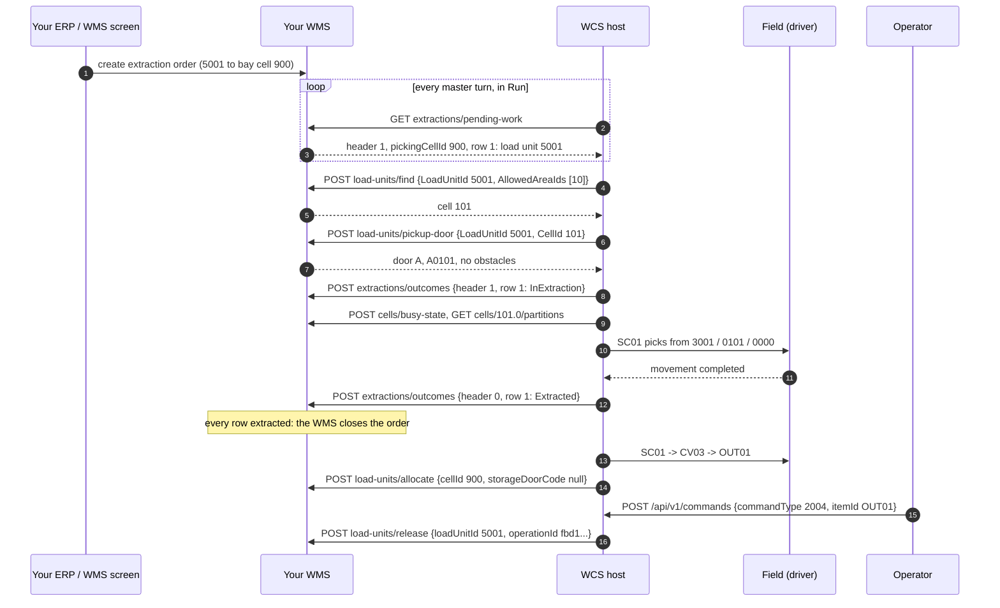

# Overview and boundary

What the WCS does, what stays in your WMS, and how the two talk. Read this first if you are
putting the WCS under an existing WMS.

## Who does what

Your WMS reasons about **goods**: what a load unit contains, where it may be stored, which orders
need which load units, when an order is complete. The machines reason about **movement**: move this
pallet from here to there. The WCS sits between them and reasons about **routes**: which devices a
load unit must go through to reach a cell or a bay, which device is free, what to do when a device
fails half-way.

| Concern | Owner | How the other side learns about it |
|---|---|---|
| Load unit master data (code, type, dimensions, handling mode) | WMS | the WCS asks: `load-units/{id}/description` |
| Cells, areas, warehouses, door codes, cell locks | WMS | the WCS asks: `cells/...`, `warehouses/{id}/topology` |
| Which cell a load unit goes to | **WMS** chooses | the WCS asks: `reservations` |
| Where a load unit physically is (in a cell) | WMS, from the WCS's facts | the WCS reports: `load-units/allocate`, `load-units/release` |
| Orders: which load units to bring to which bay, and when | WMS | the WCS pulls: `extractions/pending-work`, `notes/pending-work` |
| Closing an order | WMS | the WCS reports outcomes: `extractions/outcomes` |
| The plant: devices, arrows, addresses | **WCS** | your WMS stores, for each cell door, the field address and the device ids the WCS uses |
| Missions, routes, device states, where a load unit is on the plant | WCS | your systems read the host API and its SignalR hub |
| Talking to PLCs | WCS, through a field driver | - |

The WCS never writes your database, and your WMS never writes the WCS's. Every exchange is HTTP.

## The three contracts



1. **WCS -> WMS.** The engine calls your WMS through `IWarehouse`
   ([`Wcs.Wms.Contracts`](../../WCS/Wcs.Wms.Contracts/src)), realised over HTTP by
   [`HttpWarehouse`](../../WCS/Wcs.Wms.Client/src/HttpWarehouse.cs). You implement the server side:
   [the WMS contract](wms-contract.md), [writing an adapter](writing-a-wms-adapter.md).
2. **Your systems -> WCS.** The host API (`/api/v1`) and the hub (`/hub/plant`), with a typed .NET
   client in [`Wcs.Api.Client`](../../WCS/Wcs.Api.Client/src): [host API](host-api.md).
3. **WCS -> machines.** A field driver implements `IConnection`
   ([`Wcs.Connection.Interface`](../../WCS/Wcs.Connection.Interface/src)). This repository ships the
   loopback driver, which simulates the PLCs: [connecting machines](connecting-machines.md).

No project here references a WMS. The WCS was extracted from Sun Tech's WMS (Kazam), which talks to
it through these same contracts.

## The pull model

The WCS is not told to do work; it **pulls** work that your WMS has already decided.

- On every turn of its master loop (once a second by default, `Wcs:Engine:MasterProcessOnEvery`),
  **in Run only**, the engine asks `GET extractions/pending-work` and `GET notes/pending-work`. You
  answer with the orders that are ready for the automation. The engine queues what it can serve and
  reports each row with `POST extractions/outcomes`.
- You never call the WCS to "send" an order. You make it pending, and the next turn picks it up.
  (The sample WMS has an admin route that creates an order, standing in for your ERP:
  `POST /sample-admin/extraction-orders`.)
- Physical events go the other way, as **facts**: the WCS tells you a load unit is now in a cell
  (`load-units/allocate`) or left the automation (`load-units/release`). They are sent from durable
  queues, at least once ([facts and receipts](wms-contract.md#facts-durable-queues-and-receipts)).
- Load units enter the plant either from the field (a field driver reports a new load unit on a
  device) or by a command (`POST /api/v1/commands` with type 3002, `LoadLu`), which is what an infeed
  workstation, or the quick start, does.

When your WMS is down, the engine keeps running: readings fail and the missions that need them wait,
facts pile up in the durable queues and are delivered when the WMS answers again.

## Storing a load unit

What crossed the wire in the [quick start](../quick-start.md) when pallet 5001 was put on the infeed
bay IN01 and stored in cell 101 (the [sample plant](../../samples/plant/sample-plant.json):
IN01 -> CV01 -> CV02 -> SC01 -> ST01). Readings repeated by the engine are shown once.

```mermaid
sequenceDiagram
    autonumber
    participant Op as Operator / your system
    participant WCS as WCS host
    participant WMS as Your WMS
    participant F as Field (driver)
    Op->>WCS: POST /api/v1/commands {commandType 3002, itemId IN01, loadUnitId 5001}
    WCS->>WMS: GET load-units/5001.0/description
    WMS-->>WCS: code LU005001, type 1, 1000 x 800 x 1200
    WCS->>WMS: POST load-units/allocate {cellId 800, storageDoorCode null, operationId empty} (IN01 is linked to cell 800)
    WCS->>WMS: GET cells/800.0
    WCS->>WMS: GET warehouses/1/topology
    WCS->>WMS: GET reservations/{missionId}
    WMS-->>WCS: 404 (no reservation yet)
    WCS->>WMS: POST reservations {AssignPosition true, ReachableDeviceIds [SC01]}
    WMS-->>WCS: outcome 0, cell 101, door A0101, partition 0000
    WCS->>WMS: GET cells/101.0, GET cells/101.0/partitions
    WMS-->>WCS: door A = ASI 3001, subitem 0101; partition 0000 at offset -1
    WCS->>F: IN01 -> CV01 -> CV02 -> SC01 (one movement per hop)
    WCS->>WMS: GET reservations/{missionId} (renews it)
    WCS->>F: SC01 stores into 3001 / 0101 / 0000
    F-->>WCS: movement completed
    WCS->>WMS: GET doors/A0101/cells
    WCS->>WMS: POST load-units/allocate {cellId 101, storageDoorCode A0101, operationId 2a1d...}
    WCS->>WMS: POST reservations/release {missionId}
```

In the captured run the whole storing took about five seconds, with the loopback driver completing
each movement after 500 ms.

## Extracting an order

What crossed the wire when an extraction order for pallet 5001 (bay cell 900, device OUT01) was
created in the WMS while the pallet was stored in cell 101.



Between the turns the engine also asks `POST extractions/paused-among` for the rows it holds in its
queue: once the order is closed the sample answers `[1.0]` and the row leaves the WCS's queue.

## What the WCS keeps

The WCS keeps its own state in SQLite files next to the host (`Wcs:DatabaseDirectory`, `Data` by
default): the plant, the missions, the extraction queue, the commands and the durable queues in
`wcs.db`; the handled load units and the operators' log in monthly `wcs-history-YYYY-MM.db` files;
the field driver's message log in monthly `wcs-plc-YYYY-MM.db` files. See
[deployment and operations](deployment-and-operations.md#data-files).
