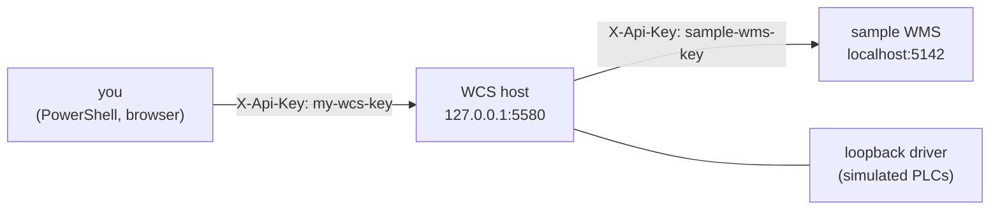

# Quick start

In about fifteen minutes, on one Windows machine, with no PLC and no WMS of your own: run the WCS
against the sample WMS, load the sample plant, open the web editor, store a pallet and bring it back
out. Every output below was produced by running these steps.

What runs:



## 1. Prerequisites

| | |
|---|---|
| Windows 10 or 11 | the platform the WCS is built and tested on (Linux is not verified) |
| [.NET 10 SDK](https://dotnet.microsoft.com/download) | `dotnet --version` prints `10.0.xxx` |
| git | to clone |
| Windows PowerShell 5.1 (part of Windows) or PowerShell 7 | the commands below; `curl.exe` (part of Windows) to see raw JSON |
| ports 5142 and 5580 free on the loopback | the sample WMS and the WCS host. Check with `netstat -ano \| findstr ":5142 :5580"`: no line means free. Otherwise see [other ports](#other-ports) |

## 2. Clone and build

```powershell
git clone https://github.com/Sun-Tech-Software/WCS.git
cd WCS
dotnet build samples/Wcs.SampleWms
dotnet build WCS/Wcs.Host/src
```

(`dotnet build Wcs.slnx` builds everything, tests included.) Every command below runs from the root
of the clone.

## 3. Start the sample WMS

First terminal:

```powershell
dotnet run --project samples/Wcs.SampleWms
```

```text
info: Microsoft.Hosting.Lifetime[14]
      Now listening on: http://localhost:5142
info: Microsoft.Hosting.Lifetime[0]
      Application started. Press Ctrl+C to shut down.
```

It answers the [WCS -> WMS contract](integration/wms-contract.md) from an in-memory warehouse: six
storage cells `A0101`-`A0302` (ids 101-106), an infeed bay cell 800, an outfeed bay cell 900, and
pallets 5001-5006 outside. It expects the key `sample-wms-key` (from its `appsettings.json`).

## 4. Start the WCS host

Second terminal. The host refuses to start with the placeholder keys of its `appsettings.json`: give
it a key of your own for its API, and the sample WMS's key for the calls it makes.

```powershell
$env:Wcs__ApiKey = 'my-wcs-key'                 # the key you send to the WCS
$env:Wms__ApiKey = 'sample-wms-key'             # the key the WCS sends to the WMS
$env:ASPNETCORE_ENVIRONMENT = 'Development'     # needed for the web editor with dotnet run
${env:Logging__LogLevel__System.Net.Http.HttpClient} = 'Warning'   # optional: quieter log
dotnet run --project WCS/Wcs.Host/src
```

On bash: `export Wcs__ApiKey=my-wcs-key Wms__ApiKey=sample-wms-key ASPNETCORE_ENVIRONMENT=Development`
and the same `dotnet run`.

The first lines, on the first start:

```text
warn: Wcs.Host.Engine.EngineHostedService[0]
      No field driver (Wcs:ConnectionFactory is not set and this build has no default): only the loopback driver is available, and devices with connection type Connected stay without connection (OffLine), and Run is refused while the plant has any
info: Wcs.Host.Engine.EngineHostedService[0]
      Motore caricato da C:\...\WCS\WCS\Wcs.Host\src\bin\Debug\net10.0\Data
info: Wcs.Host.Engine.EngineHostedService[0]
      Geometria del disegno migrata: 0 dispositivi collocati (0 con riquadro letto solo in parte), 0 senza posizione, 0 elementi senza identita', 0 senza riquadro leggibile, 0 identita' sconosciute (i numeri non sono una partizione).
info: Microsoft.Hosting.Lifetime[14]
      Now listening on: http://127.0.0.1:5580
info: Microsoft.Hosting.Lifetime[0]
      Application started. Press Ctrl+C to shut down.
info: Microsoft.Hosting.Lifetime[0]
      Hosting environment: Development
```

The warning is expected: this repository has no driver for real machines, and every device of the
sample plant uses the loopback driver. `Motore caricato da ...` is "engine loaded from": the host
keeps its data (`wcs.db` and the history) in `Data` next to its executable. `Geometria del disegno
migrata: 0 dispositivi collocati ...` ("drawing geometry migrated: 0 devices placed ...") is a
one-time conversion of the device positions of older installations, run when the host creates a
new `wcs.db`: with an empty plant every count is 0, and later starts do not print it. The host
listens on the loopback only, and the engine starts **stopped**, with an empty plant.

Without the optional `HttpClient` line, the host also logs every call it makes to the WMS (four
`info: System.Net.Http.HttpClient...` lines per call, starting with `Start processing HTTP request`):
harmless, but they bury the engine's own lines once the engine runs.

Why `Development`: `dotnet run` serves the web editor's files from the source folders only in the
Development environment. An installation uses `dotnet publish` instead
([deployment](integration/deployment-and-operations.md#publish)). Development also serves the API's
OpenAPI document at `/openapi/v1.json`.

Check the host from a third terminal:

```powershell
curl.exe -s http://127.0.0.1:5580/api/v1/status -H "X-Api-Key: my-wcs-key"
```

```json
{"navStatus":0,"defragmentation":0,"version":"0.1.0.0","utcNow":"2026-10-15T02:51:58.7928188Z","historyFrom":"2026-10-01","engineLoadError":null}
```

`navStatus` 0 is Stop; `engineLoadError` null means the engine is loaded. Without the key the host
answers `401` (`"title":"Chiave assente o sbagliata"`, "key missing or wrong").

## 5. Load the sample plant

```powershell
powershell -NoProfile -ExecutionPolicy Bypass -File ./samples/plant/load-sample-plant.ps1 -ApiKey my-wcs-key
```

```text
Plant loaded into http://127.0.0.1:5580 : 7 devices, 7 junctions, 8 door mappings.
Start the engine with: POST http://127.0.0.1:5580/api/v1/commands  { "commandType": 1001 }
```

`-ExecutionPolicy Bypass` applies to this run only: Windows PowerShell refuses scripts by default. With
PowerShell 7, `pwsh` instead of `powershell` works the same. The script takes the edit lease, sends
[`sample-plant.json`](../samples/plant/sample-plant.json) with `PUT /api/v1/plant/graph` and gives the
lease back ([host API](integration/host-api.md#the-edit-lease-423)). When the host refuses a call,
the script prints one line with the host's reason and exits with code 1, for example
`The host refused PUT http://127.0.0.1:5580/api/v1/plant/graph with 409: Impossibile sostituire il grafo con lavoro pendente - Ci sono missioni attive in memoria`
("cannot replace the graph with pending work - there are active missions in memory"): see
[troubleshooting](#troubleshooting-the-first-run). The plant:

```text
IN01 --> CV01 --> CV02 --> SC01 <--> ST01 (rack A: cells 101-106, doors A0101 ... A0302)
                             |
                             v
                           CV03 --> OUT01
```

IN01 is the infeed bay (linked to WMS cell 800, it asks the WMS for a storage cell), CV01-CV03 are
conveyors, SC01 the stacker crane, ST01 the rack, OUT01 the outfeed bay (linked to cell 900). All
devices use the loopback driver, which completes each movement after 500 ms
([plant modelling](integration/plant-modelling.md)).

## 6. Open the web editor

Open <http://127.0.0.1:5580/editor>. It redirects to `/editor/drawio` and asks for the key:

> **WCS Web Editor**
> The API key is needed to talk to the host.
> [ API key ] **Connect**

Type `my-wcs-key` and press **Connect**. The page checks the key against the host
(`GET /api/v1/status`) before showing anything: a wrong key gives "Key rejected by the host", a host
that does not answer gives "The host is not answering: check that it is running and reachable". The
editor runs on the server (Blazor): the key you type stays in your editor session there, which calls
the API with it. Then you see the seven devices of the plant, their live state and, in the
**Plant file** window, the export and import of the whole plant.

Keep the editor open during the next steps: the pallet moves on the drawing.

## 7. Start the engine

```powershell
$wcs = @{ 'X-Api-Key' = 'my-wcs-key' }
$wms = @{ 'X-Api-Key' = 'sample-wms-key' }
$started = Get-Date                             # for the operators' log of step 8
Invoke-RestMethod -Method Post http://127.0.0.1:5580/api/v1/commands -Headers $wcs -ContentType application/json -Body '{ "commandType": 1001 }'
```

The command is queued (`201`, `status` 0) and executed on one of the engine's next turns, within a
few seconds (two to three on the machines these outputs come from). Wait until the status says Run:

```powershell
curl.exe -s http://127.0.0.1:5580/api/v1/status -H "X-Api-Key: my-wcs-key"
```

```json
{"navStatus":1,"defragmentation":0,"version":"0.1.0.0","utcNow":"2026-10-15T02:52:03.8760212Z","historyFrom":"2026-10-01","engineLoadError":null}
```

From now on the WCS asks the WMS for pending work once a second (`GET extractions/pending-work`,
`GET notes/pending-work`), and accepts the commands that move load units (before Run they are
refused with `503`, `Il motore è in Stop: il comando 3002 richiede Run`).

## 8. Put pallet 5001 on the infeed

Command 3002 (`LoadLu`) on IN01 says "a load unit is now on this device":

```powershell
Invoke-RestMethod -Method Post http://127.0.0.1:5580/api/v1/commands -Headers $wcs -ContentType application/json `
  -Body '{ "commandType": 3002, "itemId": "5a000000-0000-4000-8000-000000000001", "loadUnitId": 5001 }'
```

What the WCS does, in order (the [overview](integration/overview-and-boundary.md#storing-a-load-unit)
draws it): asks the WMS what 5001 is (`GET load-units/5001.0/description`); reports it in the bay
cell 800 (`POST load-units/allocate`); asks for a storage cell (`POST reservations`: the sample answers
cell 101, door `A0101`); carries the pallet IN01 -> CV01 -> CV02 -> SC01 -> ST01; reports it stored
(`POST load-units/allocate` on door `A0101`) and releases the reservation.

While it travels, the active mission (here already bound for ST01, door `A0101`, field address
`3001` / `0101` / `0000`):

```powershell
curl.exe -s http://127.0.0.1:5580/api/v1/missions -H "X-Api-Key: my-wcs-key"
```

```json
[{"missionId":"28497dc5-0af2-4356-9e4c-504ab07ae4aa","loadUnitId":5001.0,"loadUnitCode":"LU005001","positionItemId":"5a000000-0000-4000-8000-000000000001","sourceItemId":"5a000000-0000-4000-8000-000000000001","destinationItemId":"5a000000-0000-4000-8000-000000000005","date":"2026-10-15T04:52:04.7267222+02:00","statusDescription":"","storageDoorCode":"A0101","pickUpDoorCode":"","status":0,"commandId":2,"relocateItemId":null,"missionType":5,"movingDescription":"","operationType":0,"bufferCellId":0,"extractionQueueId":0,"loadUnitTypeId":1,"groupedMovementId":null,"handlingMode":0,"gatewayItemId":"5a000000-0000-4000-8000-000000000002","sourceAsi":null,"sourceSubitem":null,"sourcePartition":null,"destinationAsi":"3001","destinationSubitem":"0101","destinationPartition":"0000","noteAssignmentId":0,"assignmentGuid":null,"noteProcessingId":0,"activeFilter":false,"tare":25,"reallocatedDestination":false,"operatorDestination":false,"pendingChange":null,"pendingChangeItemId":null,"relocatorArrival":null}]
```

Within ten seconds of command 3002 (five to seven on the machines these outputs come from) the WMS
has it in cell 101:

```powershell
curl.exe -s http://localhost:5142/api/wcs/warehouse/load-units/5001/location -H "X-Api-Key: sample-wms-key"
```

```json
{"loadUnitId":5001,"cellId":101,"storingDepth":1200}
```

Asked right after command 3002, the answer can be a `404` instead, because the WCS has not told the
WMS about the pallet yet: `curl.exe` prints a problem whose `detail` is
`Load unit 5001 is not in any cell.`, and `Invoke-RestMethod` throws `(404) Not Found`. A moment
later the answer can be cell 800: the pallet is on the infeed bay, which is linked to that cell. Ask
again a few seconds later. The operators' log since step 7 tells the story. The host returns it
newest first; `Sort-Object id` puts it in the order it happened, oldest first:

```powershell
$from = $started.ToString('s'); $to = (Get-Date).AddHours(1).ToString('s')
(Invoke-RestMethod "http://127.0.0.1:5580/api/v1/log?from=$from&to=$to" -Headers $wcs) | Sort-Object id | ForEach-Object description
```

```text
Workstation  requested: Navigator Run
Workstation  requested: Unload Lu LU005001 on Item 1001.0001.0001
Moved LU LU005001 from 1001.0001.0001 to 1002.0001.0001
Moved LU LU005001 from 1002.0001.0001 to 1003.0001.0001
Moved LU LU005001 from 1003.0001.0001 to 2001.0001.0001
Stored LU LU005001 from 2001.0001.0001 to 3001.0001.0001
Stored LU LU005001 to A0101
```

The second line records command 3002 with the wording of an unload: a known defect of that log
line, nothing is unloaded. The addresses are the field addresses of the devices (IN01 is
`1001.0001.0001`, SC01 `2001.0001.0001`, ST01 `3001.0001.0001`).

## 9. Ask for it back

Create an extraction order in the WMS, as its users would. This route is the sample's own
(`/sample-admin`), not part of the contract: in your WMS, orders come from your ERP or your screens.

```powershell
Invoke-RestMethod -Method Post http://localhost:5142/sample-admin/extraction-orders -Headers $wms -ContentType application/json `
  -Body '{ "loadUnitIds": [ 5001 ] }'
```

```json
{"orderId":1,"pickingCellId":900,"rows":[{"rowId":1,"loadUnitId":5001}]}
```

On its next turn the WCS reads the order (`GET extractions/pending-work`), finds the pallet in cell
101 (`POST load-units/find`), reports the row in extraction, and the crane brings it
ST01 -> SC01 -> CV03 -> OUT01. When the crane picks it the WCS reports the row extracted
(`POST extractions/outcomes`) and the sample WMS closes the order; when it reaches OUT01 the WCS
reports it in the bay cell 900 (`POST load-units/allocate`). Within ten seconds of the order (six to
eight on the machines these outputs come from):

```powershell
(Invoke-RestMethod http://127.0.0.1:5580/api/v1/plant/items/status -Headers $wcs) |
    Where-Object name -eq 'OUT01' | Select-Object name, status, luLoadStatus, loadedLuCode
```

```text
name  status luLoadStatus loadedLuCode
----  ------ ------------ ------------
OUT01      0            1 LU005001
```

## 10. Take it off the bay

Command 2004 (`ItemUnloadLu`) on OUT01: the pallet leaves the automation.

```powershell
Invoke-RestMethod -Method Post http://127.0.0.1:5580/api/v1/commands -Headers $wcs -ContentType application/json `
  -Body '{ "commandType": 2004, "itemId": "5a000000-0000-4000-8000-000000000007" }'
```

The WCS reports `POST load-units/release` and the WMS marks pallet 5001 shipped.

## 11. What the WMS saw

```powershell
(Invoke-RestMethod http://localhost:5142/sample-admin/state -Headers $wms).journal | Select-Object route, what
```

```text
route                what
-----                ----
load-units/allocate  load unit 5001 is in cell 800 (operator cell)
reservations         cell 101 (door A0101) reserved for load unit 5001, mission 28497dc5-0af2-4356-9e4c-504ab07ae4aa
load-units/allocate  load unit 5001 is in cell 101 (stored through door A0101)
reservations/release mission 28497dc5-0af2-4356-9e4c-504ab07ae4aa released cell 101
sample-admin         extraction order 1 created: load units 5001 to cell 900
extractions/outcomes order 1, row 1 (load unit 5001): InExtraction
extractions/outcomes order 1, row 1 (load unit 5001): Extracted
extractions/outcomes order 1 closed: every row extracted
load-units/allocate  load unit 5001 is in cell 900 (operator cell)
load-units/release   load unit 5001 left the automation
```

`state` also has the cells, load units, reservations, orders, and `recentCalls`: every route the WCS
called, with its status and how many times.

## 12. Stop

Stop the engine (command 1002), then `Ctrl+C` in the host's terminal and in the sample WMS's:

```powershell
Invoke-RestMethod -Method Post http://127.0.0.1:5580/api/v1/commands -Headers $wcs -ContentType application/json -Body '{ "commandType": 1002 }'
```

The sample WMS keeps everything in memory: restarting it brings back six empty cells. The WCS keeps
its plant and missions in `wcs.db`: the plant is still there at the next start. To run the steps
again on the same host, stop the engine and load the plant again (step 5); to start from scratch,
delete the host's `Data` folder (`WCS/Wcs.Host/src/bin/Debug/net10.0/Data`) while the host is
stopped.

## The same, as a test

```powershell
dotnet test samples/Wcs.SampleWms.Test --filter QuickStartEndToEndTest
```

It starts the sample WMS and a WCS host on free ports with a temporary data folder, runs the plant
script and steps 7 to 10, and checks each step through the WMS contract.

## Other ports

```powershell
# terminal 1: the sample WMS on 6142
dotnet run --project samples/Wcs.SampleWms --urls http://localhost:6142

# terminal 2: the host on 6580, calling the WMS on 6142 (the first four lines are those of step 4)
$env:Wcs__ApiKey = 'my-wcs-key'
$env:Wms__ApiKey = 'sample-wms-key'
$env:ASPNETCORE_ENVIRONMENT = 'Development'
${env:Logging__LogLevel__System.Net.Http.HttpClient} = 'Warning'   # optional: quieter log
$env:Wms__ApiAddress = 'http://localhost:6142'
$env:Kestrel__Endpoints__Http__Url = 'http://127.0.0.1:6580'
dotnet run --project WCS/Wcs.Host/src

# terminal 3
powershell -NoProfile -ExecutionPolicy Bypass -File ./samples/plant/load-sample-plant.ps1 -HostUrl http://127.0.0.1:6580 -ApiKey my-wcs-key
```

In the commands of the following steps, write 6580 for 5580 and 6142 for 5142.

Do not set `Kestrel__Endpoints__Http__Url` in the terminal where you start the sample WMS: it would
override `--urls` (the sample logs `Overriding address(es) 'http://localhost:6142'`) and try to take
the host's port.

## Troubleshooting the first run

| What you see | Why | What to do |
|---|---|---|
| the host exits with `Wcs:ApiKey manca o e' quella di esempio: senza chiave l'host non parte.` | no `Wcs__ApiKey` in that terminal | set it (step 4) in the same terminal as `dotnet run` |
| the host exits with `Wms:ApiKey manca o è quella di esempio: ...` | no `Wms__ApiKey` | set it to `sample-wms-key` |
| `Failed to bind to address http://127.0.0.1:5580: address already in use.` (or `localhost:5142` for the WMS) | the port is taken | [other ports](#other-ports) |
| the sample WMS says `Overriding address(es) ...` and listens on 5580 | `Kestrel__Endpoints__Http__Url` set in its terminal | open a new terminal for it |
| the script fails with `running scripts is disabled on this system` | PowerShell's execution policy | use the command of step 5, with `-ExecutionPolicy Bypass` |
| the script says `The engine is not stopped (navStatus 1). Stop it first: ...` | the plant is replaced only in Stop | command 1002, then the script again |
| the script says `The host refused PUT .../plant/graph with 409: Impossibile sostituire il grafo con lavoro pendente - ...` ("cannot replace the graph with pending work") | a load unit is still on its way: the engine was stopped before its mission ended (`GET /api/v1/missions` lists it) | start the engine (step 7), let the mission end, stop the engine and run the script again; or, to start from scratch, stop the host, delete its `Data` folder and start it again |
| the script says `The host refused POST .../plant/edit-lock with 409: the edit lease is held by ...` | another client holds the edit lease ([host API](integration/host-api.md#the-edit-lease-423)) | wait until the time it names, then run the script again |
| the script says `Cannot reach the host: ...` | no host at the script's address | start the host (step 4); with [other ports](#other-ports), pass `-HostUrl` |
| `/editor` stays blank | the host is not in Development | `$env:ASPNETCORE_ENVIRONMENT = 'Development'` before `dotnet run` |
| 3002 answers `503`, `Il motore è in Stop: il comando 3002 richiede Run` | the engine is not in Run yet | wait for `navStatus` 1 (step 7) |
| `401` from the WCS | wrong or missing `X-Api-Key` | `my-wcs-key` (what you set in `Wcs__ApiKey`) |
| `401` from the sample WMS | wrong key for the WMS | `sample-wms-key` |
| a command rewritten for `curl.exe` answers `400`, `"title":"Richiesta non leggibile"` ("request not readable"), `detail` `Failed to read parameter ... as JSON.` | the body is not JSON. PowerShell 7.3 and later pass `\"` to `curl.exe` as it is, so `-d '{ \"commandType\": 1002 }'` sends the backslashes | in PowerShell 7.3+ write `-d '{ "commandType": 1002 }'`; in Windows PowerShell 5.1, `\"`; or use `Invoke-RestMethod` as the steps above do |
| the pallet stays on IN01 and the host log repeats `Il gestionale non ha risposto a «...»` | the host cannot reach the WMS | is the sample WMS running on the port of `Wms__ApiAddress`? Is `Wms__ApiKey` `sample-wms-key`? |
| location answers `404` (`Load unit 5001 is not in any cell.`, or `(404) Not Found` from `Invoke-RestMethod`) right after 3002 | asked too early: the WMS has not been told about the pallet yet | ask again a few seconds later |
| location answers cell 800, not 101 | asked too early: the pallet is still on the bay | ask again a few seconds later |

More in [troubleshooting](integration/troubleshooting.md).
